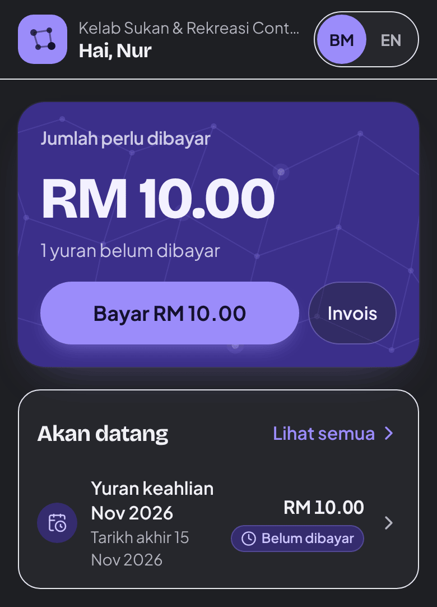
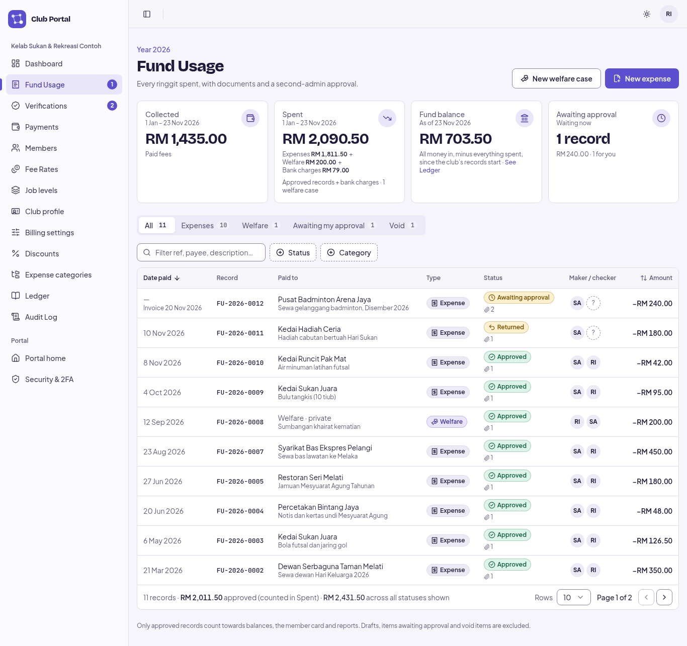

# Club Portal

*Portal yuran kelab: bayar yuran, semak slip, rekod perbelanjaan dengan kelulusan dua orang.*

Club Portal is a self-hosted web app for small staff clubs in Malaysia. Members pay their club fees online (FPX) or by
free bank / DuitNow transfer with a slip, and get a receipt. Committee members record every ringgit spent with
documents, and a second admin has to approve it before it counts. It runs on ordinary cPanel PHP hosting: no Node
process on the server.

**Status:** in active development and not yet live with real payments. Before using it for real money, work through
the [before-go-live checklist](docs/option-a-report.md#before-go-live-checklist), starting with a ToyyibPay or
Billplz sandbox run on your own host.

<table>
  <tr>
    <td align="center"><br><sub>Member home</sub></td>
    <td align="center"><br><sub>Pay by transfer, no charge</sub></td>
    <td align="center"><br><sub>Official receipt</sub></td>
    <td align="center"><br><sub>Bayar semua: every open fee at once</sub></td>
    <td align="center"><br><sub>Dark theme</sub></td>
  </tr>
</table>


## Features

**For members** (installable web app, Bahasa Melayu by default, English toggle, light/dark theme)
- Home shows the amount due on a membership card, upcoming fees (oldest first), recent payments and club-wide totals
  of where the money went, with category names in BM (totals only: no payees, documents or other members' names).
- **Bayar semua**: with more than one fee open, pay them all with one FPX bill (one gateway charge) or one transfer
  slip (`YURAN-G{id}`); "Bayar satu sahaja" still pays just the oldest.
- **Review & pay** ("Semak & bayar") with a choice of:
  - **FPX** through the club's gateway (ToyyibPay or Billplz);
  - **bank / DuitNow transfer** ("Pindahan bank / DuitNow"): the page shows the club's account and a `YURAN-{id}`
    reference, the member uploads 1–3 slips (photo or PDF) and the fee shows "Menunggu pengesahan" until a
    treasurer approves it.
- Invoice and official receipt ("Resit rasmi") for every fee, with a print button, headed with the club's logo,
  name, registration no. and address. A receipt keeps the club details it was issued with.
- Payment history by year and **pay ahead** ("Bayar lebih awal") for 1, 3 or 12 months, using the plans the club allows.
- Add to home screen (PWA) with a small install tip.

**For club admins (treasurer, secretary)**
- **Dashboard**: fund balance, collected and spent this year (expenses + welfare + bank charges), records awaiting
  approval, a 12-month chart, transfer slips (a "Bayar semua" slip is one row) and approvals waiting, recent money
  events. Dashboard, Fund Usage, Ledger and the member card all use one set of fund figures, each with its period.
- **Fund Usage** (expenses and welfare / "kebajikan" contributions) with **maker-checker**: one admin records it with
  invoices, receipts or bank slips, a different admin approves it with a conflict-of-interest declaration (or returns
  it with a reason). Approved records can't be edited; voiding needs two admins. Only approved records count in
  balances and reports.
- **Payment verifications**: check members' transfer slips against the bank statement, approve (the member gets the
  receipt by email) or reject with a reason (the member is emailed and can send a new slip). A "Bayar semua" slip is
  approved or rejected as one set.
- **Club profile**: the club's name, logo, contact email, registration no. (ROS/PPM), address and the month its
  financial year starts ("this year" on the dashboard, Fund Usage, ledger and member pages then runs from that
  month). Logos are PNG / JPEG / WebP only, re-encoded on the server.
- **Billing settings**: which plans members may choose, the default plan, who pays the gateway fee, and the club's
  bank / DuitNow details. A change to the bank details waits for a second admin to approve it.
- Members (add one by one or import CSV, welcome email with a temporary password), **job levels** each club defines
  for itself (a new club starts with one, "Ahli"; rename, reorder, add or deactivate them), fee rates per job level,
  discounts, payments, expense categories (with an optional BM name for members).
- **Ledger** with period presets, an opening balance worked out from the records (or set by hand, clearly marked),
  money in / out tiles, month-by-month table or chart, running balance, monthly bank-charge rows and outstanding fees,
  exported as CSV (Excel-ready) or PDF (A4 landscape for the AGM). The user guide says
  [which figure to quote at the AGM](docs/USER-GUIDE.md#the-ledger-and-the-agm).
- Per-club audit log.

**For the super admin**
- Clubs (including each club's gateway and credentials), administrators, platform statistics and the platform-wide
  audit log. Only the super admin can make someone a club admin.

## Screenshots

| | |
|---|---|
|  |  |
| Fund Usage: every record, its documents and who made / checked it | A record waiting for a second admin, with documents and audit trail |
|  |  |
| Payment verifications: transfer slips to check | Billing settings: a bank details change waiting for a second admin |
|  |  |
| Ledger with CSV / PDF export | Dark theme |

More, with step-by-step instructions, in the [user guide](docs/USER-GUIDE.md). All names, emails, bank details and
amounts in the screenshots are made up.

## Tech stack

- **Backend:** Laravel 13 (PHP 8.4); MariaDB 10.11 or MySQL 8.0+ for a live site, SQLite for a local copy and the
  tests; database sessions, cache and queue.
- **Front end:** member pages and the main admin pages (dashboard, Fund Usage, verifications, ledger, billing) use
  Inertia 2 + React 18 + TypeScript + Tailwind 3, built with Vite. Sign-in pages are Blade with the same Tailwind
  styles. The remaining admin pages and the installer are Blade with Bootstrap 5 (re-skinned to the same look and
  sidebar), bundled by Vite from npm like the rest (jsDelivr with Subresource Integrity hashes only as a fallback
  when `public/build` is missing). Fonts are self-hosted; no page calls a third-party host in normal use.
- **Payments:** ToyyibPay and Billplz behind one gateway interface (per-club choice and credentials), plus manual
  bank / DuitNow transfer.
- **Other:** `pragmarx/google2fa` (TOTP 2FA), `barryvdh/laravel-dompdf` (ledger PDF), Recharts (charts).

## Requirements

- PHP **8.4** with your database's PDO driver (`pdo_mysql` for MariaDB / MySQL, `pdo_sqlite` for SQLite) and the
  usual Laravel extensions.
- A database: **MariaDB 10.11** or **MySQL 8.0+** for a live site; SQLite for a local copy and the tests.
- Composer and Node 22 **only to build** a release (`scripts/build-release.sh`; CI does it for each `v*` tag). The
  server never runs Composer or Node.

The full list, with the extensions and why each is needed, is in [docs/INSTALL.md](docs/INSTALL.md#1-what-you-need).

## Quick start (local development)

```bash
git clone https://github.com/amirsubhi/clubcollection.git club-portal && cd club-portal
composer install
cp .env.example .env && php artisan key:generate
touch database/database.sqlite
php artisan migrate
php artisan db:seed            # demo data, local/testing only
npm ci && npm run build        # or `npm run dev` while working on the React pages
touch storage/app/.installed   # skip the installer locally
php artisan serve
```

The demo seeder creates a super admin `superadmin@example.com` whose password is `SEED_SUPER_ADMIN_PASSWORD` from
`.env`, or a random one it prints once. There is no well-known default password. It also creates a sample club with
members, fees and Fund Usage records. It refuses to run unless `APP_ENV` is `local` or `testing`.

`composer dev` runs the server, queue listener and log tail together.

## Installing on cPanel (summary)

**Follow [docs/INSTALL.md](docs/INSTALL.md) for a first install**: it has every step, the `.env` values, MySQL,
backups and troubleshooting. Upgrades are in [docs/RELEASE.md](docs/RELEASE.md). In short:

1. Download `clubportal-<version>.zip` (with `vendor/` and `public/build/` inside) and its `.sha256` from the GitHub
   Release, or build it with `scripts/build-release.sh <version>`.
2. Upload and extract it in cPanel File Manager, point the domain's document root at its `public/`, and
   `chmod -R 775 storage bootstrap/cache`.
3. Create `.env` (`key:generate`, `APP_ENV=production`, `APP_DEBUG=false`, the exact `https://` `APP_URL`, a random
   `INSTALL_TOKEN` of 16+ characters), then `php artisan storage:link` and **`php artisan migrate --force`** (before
   `/install`, which returns a 500 error until the tables exist).
4. Open `https://<your-domain>/install` straight away: it asks for the token and creates the super admin.
5. Set the `MAIL_*` SMTP settings (without them no email goes out), `TOYYIBPAY_WEBHOOK_SECRET` (32+ characters) and
   `BILLPLZ_X_SIGNATURE_KEY` if you use Billplz, PHP `upload_max_filesize = 12M` / `post_max_size = 32M`, and
   `TRUSTED_PROXIES` if your host has a proxy in front of PHP. Run `php artisan config:cache` after **any** `.env` change.
6. Add a cron job every minute: `cd /path/to/app && php artisan schedule:run`. It sends the overdue-fee reminders
   daily at 08:00 in the app time zone (`APP_TIMEZONE`): 8 am Malaysia time with the recommended
   `APP_TIMEZONE=Asia/Kuala_Lumpur`, which the installer sets (UTC when unset, i.e. 4 pm in Malaysia). Dates on
   receipts, the ledger and the dashboard follow the same time zone. No queue worker is needed.

> **The March 2026 GitHub release `v1.0.0` is superseded.** Do not upgrade a `v1.0.0` site in place: some columns
> were added by editing existing migrations, so its database will not match. Install the next release tag fresh
> instead (an existing database from an earlier build needs `php artisan migrate:fresh --force`, which deletes all
> data). **From the first real install onwards, every schema change is a new, additive migration**; existing
> migrations are never edited again.

## Payments

- **ToyyibPay** and **Billplz** (FPX). The super admin picks each club's gateway and stores its credentials (encrypted);
  `.env` holds global fallbacks. Set `TOYYIBPAY_SANDBOX=true` / `BILLPLZ_SANDBOX=true` for testing.
- A paid ToyyibPay callback is confirmed with ToyyibPay's `getBillTransactions` before the fee is marked paid
  (`TOYYIBPAY_VERIFY_CALLBACK`, on by default). Billplz callbacks are checked with the X-Signature.
- **Gateway fee:** the club chooses whether it absorbs the per-bill fee or members pay it. For ToyyibPay, "member pays"
  stays disabled until `TOYYIBPAY_CHARGE_VERIFIED=true` (after a sandbox check).
- **Bank / DuitNow transfer** costs nothing: members upload a slip and an admin verifies it.
- **"Bayar semua"** puts every open fee in one bill (one gateway charge) or one slip; the webhook settles the whole
  set in one transaction, or none of it.
- **Bank charges:** gateway fees the club absorbs count as spending (shown as "Bank charges" and as monthly ledger
  rows). Other bank charges are recorded as a normal expense; see the
  [user guide](docs/USER-GUIDE.md#bank-and-gateway-charges).
- Fee comparison and advice for committees: [docs/payment-options.md](docs/payment-options.md).

## Security highlights

- **Maker-checker where money moves:** Fund Usage approval and voiding, and bank / DuitNow detail changes, need a
  second admin (the super admin can act as one). Any one club admin can verify a member's transfer slip, but not a
  slip for their own fee: that needs another admin.
- **Own-fee rule:** a club admin can't approve their own slip, mark their own fee paid, or change its amount or
  discount (the super admin is exempt).
- **2FA** (TOTP with recovery codes) for any user; codes can't be reused and the challenge locks after 5 wrong codes.
- **Private, encrypted files:** documents and slips are encrypted at rest with `APP_KEY` on a private disk and served
  only to that club's admins (and a member's own slip); opening or downloading a document is audited. Welfare personal details are encrypted columns.
- **Audit log** of every write, with old/new values, user, IP and user agent.
- Fail-closed webhooks with a per-bill HMAC token, CSP with nonces, rate limits on login, 2FA, password reset,
  installer and uploads, CSV formula-injection protection on exports, and production URLs pinned to `APP_URL`.

**You are responsible for securing your own deployment**: HTTPS only, `APP_DEBUG=false`, a backed-up `APP_KEY`
(without it the stored documents can't be read), regular database and `storage/app/private` backups, and
`TRUSTED_PROXIES` if your host puts a proxy in front of PHP. See [docs/INSTALL.md](docs/INSTALL.md#6-backups).

To report a security vulnerability, please don't open a public issue: see [SECURITY.md](SECURITY.md).

## Testing

```bash
php artisan test          # PHPUnit feature and unit tests (SQLite in memory)
npm run typecheck         # tsc --noEmit
npm run build             # production build
```

SQLite ignores column lengths, so the suite also has to pass on MariaDB and MySQL. CI
([.github/workflows/tests.yml](.github/workflows/tests.yml)) runs it on SQLite, MariaDB 10.11 and MySQL 8.0 for every
push to `master` and every pull request. To run it on your own MariaDB / MySQL, point it at an empty test database
(it is wiped):

```bash
DB_CONNECTION=mariadb DB_HOST=127.0.0.1 DB_PORT=3306 DB_DATABASE=clubportal_test \
  DB_USERNAME=... DB_PASSWORD=... php artisan test
```

An end-to-end browser smoke test (Playwright) covers paying online, paying by transfer, Fund Usage approval and slip
verification against a running server: see [tests/e2e/README.md](tests/e2e/README.md).

## Documentation

| Document | What it covers |
|---|---|
| [docs/INSTALL.md](docs/INSTALL.md) | First install: requirements, local and cPanel steps, MySQL, backups, troubleshooting |
| [docs/USER-GUIDE.md](docs/USER-GUIDE.md) | Task-based guide for members, treasurers / club admins and the super admin |
| [docs/RELEASE.md](docs/RELEASE.md) | Building a release, upgrading, production `.env`, upload limits, PWA service worker |
| [docs/payment-options.md](docs/payment-options.md) | Gateway fees compared, recommendation for small clubs |
| [docs/option-a-report.md](docs/option-a-report.md) | Build log, review findings and the before-go-live checklist |
| [tests/e2e/README.md](tests/e2e/README.md) | Running the end-to-end smoke test |
| [CHANGELOG.md](CHANGELOG.md) | Changes by release |
| [SECURITY.md](SECURITY.md) | Reporting a vulnerability, supported versions, security model |
| [CREDITS.md](CREDITS.md), [docs/THIRD-PARTY-LICENSES.md](docs/THIRD-PARTY-LICENSES.md) | Licences, copyright notices and acknowledgements |
| [mockup/README.md](mockup/README.md) | The design mockup the React pages were built from |

## Disclaimer

**This software is provided "as is", without warranty of any kind, express or implied.**

The author(s) of this project accept **no liability** for:

- Any data breaches, unauthorized access, or security incidents arising from your deployment or configuration of this software
- Loss of data, financial loss, or any other damages resulting from the use or misuse of this software
- Security vulnerabilities in third-party dependencies, hosting environments, or integrations (including ToyyibPay and Billplz)
- Any consequences of failing to follow the security guidelines above

By deploying this software, you agree that you are solely responsible for securing your environment, protecting user data, and complying with applicable laws and regulations (including data protection and privacy laws such as PDPA, GDPR, etc.).

This disclaimer does not override any rights you may have under the MIT License.

## Licence

Licensed under the [MIT License](LICENSE). Copyright (c) 2026 Amir Subhi and clubcollection contributors.

## Credits

Club Portal builds on open-source work: Laravel, Inertia, React, Radix UI, Tailwind CSS, Recharts, Lucide, dompdf,
Bootstrap, Chart.js and many smaller packages, with UI primitives in the style of shadcn/ui and an admin layout
modelled on shadcn-admin. [CREDITS.md](CREDITS.md) lists the direct dependencies with their licences and copyright
holders, the LGPL notes for dompdf, the design acknowledgements and the trademarks notice;
[docs/THIRD-PARTY-LICENSES.md](docs/THIRD-PARTY-LICENSES.md) lists every shipped package, and their full licence
texts are served by every install at `/licenses.txt` ([public/licenses.txt](public/licenses.txt)).

Most packages are MIT. The exceptions worth knowing: `dompdf/dompdf` (LGPL-2.1), `dompdf/php-font-lib`
(LGPL-2.1 or later) and `dompdf/php-svg-lib` (LGPL-3.0 or later), used unmodified as separate Composer packages; `bacon/bacon-qr-code` (BSD-2-Clause);
`lucide-react` (ISC); `class-variance-authority` (Apache-2.0).

---

Built by [@amirsubhi](https://github.com/amirsubhi).
