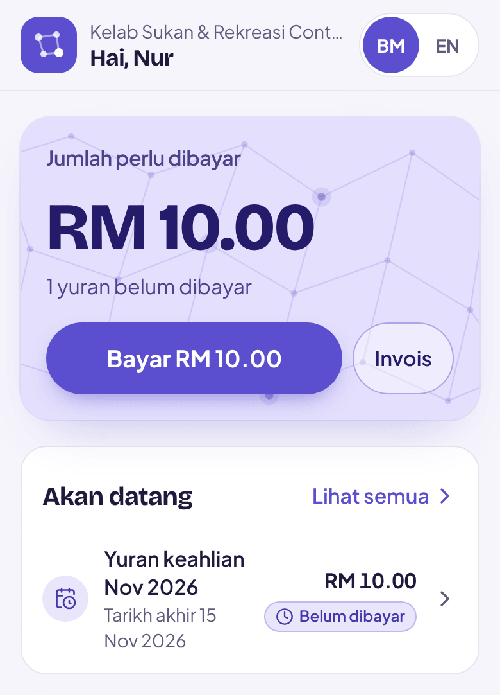
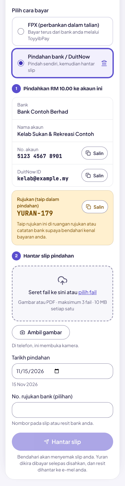
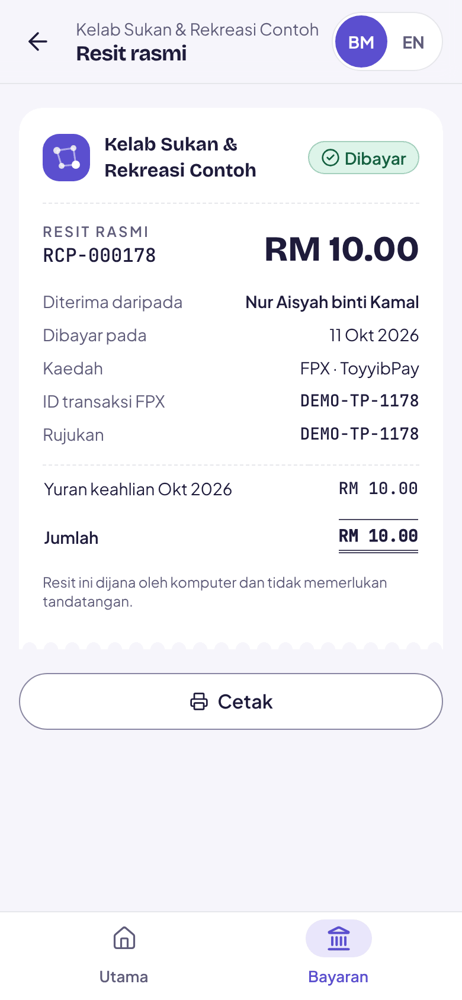
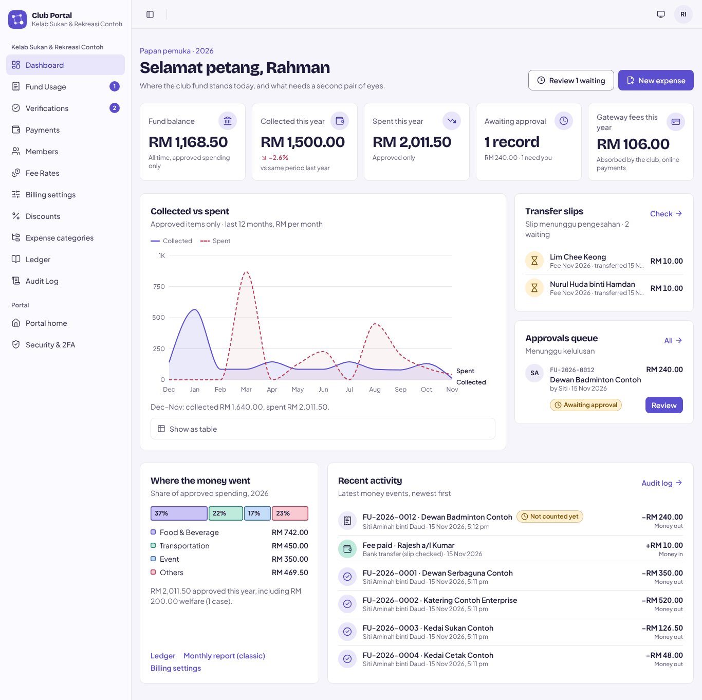
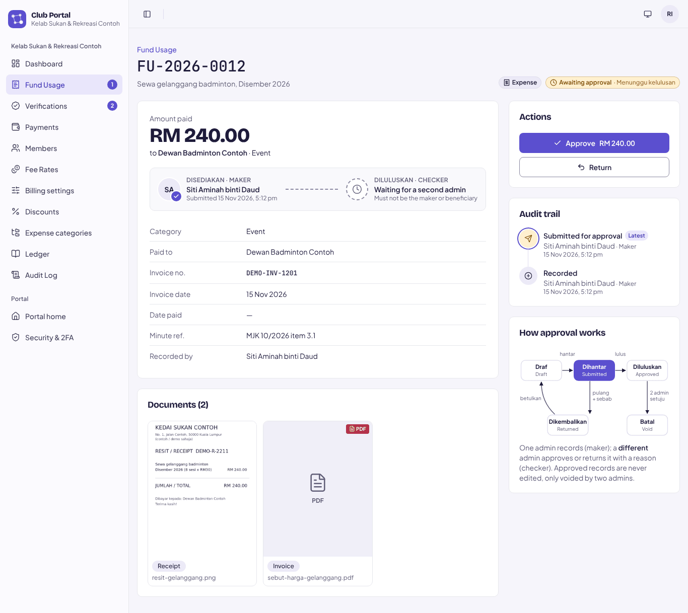
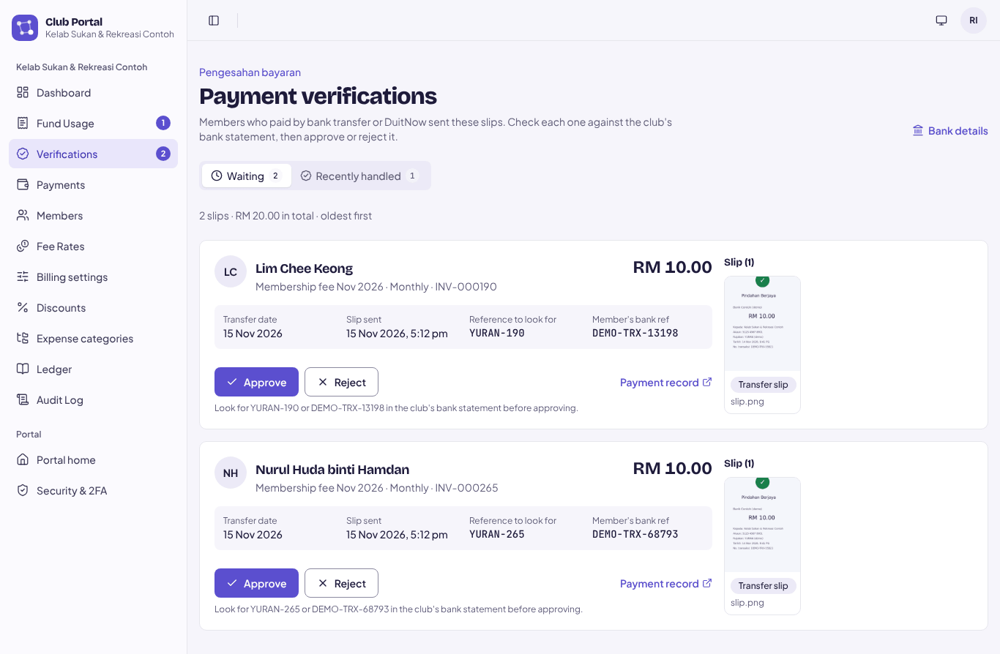
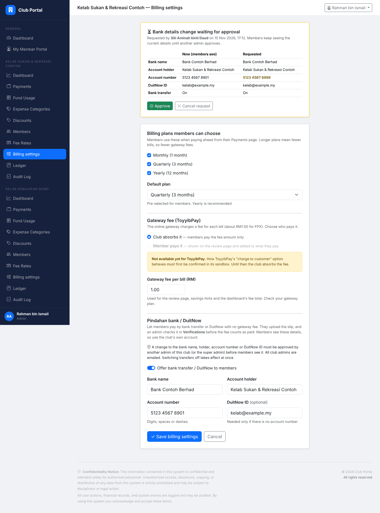
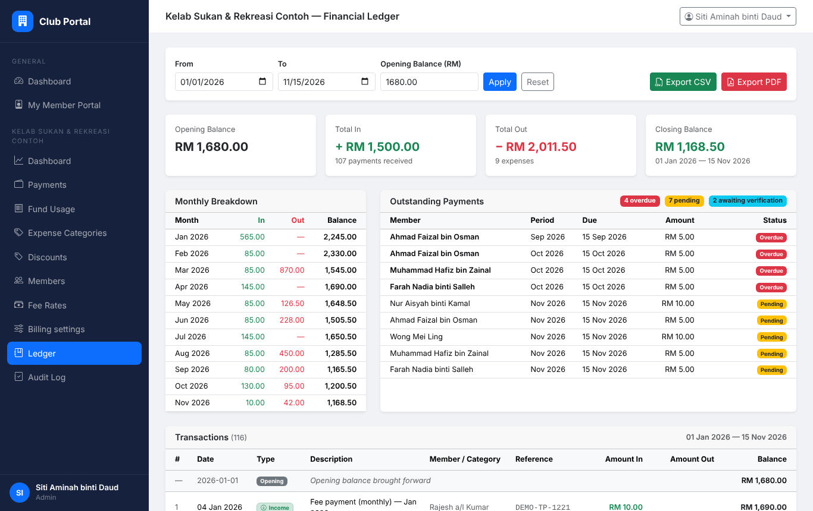
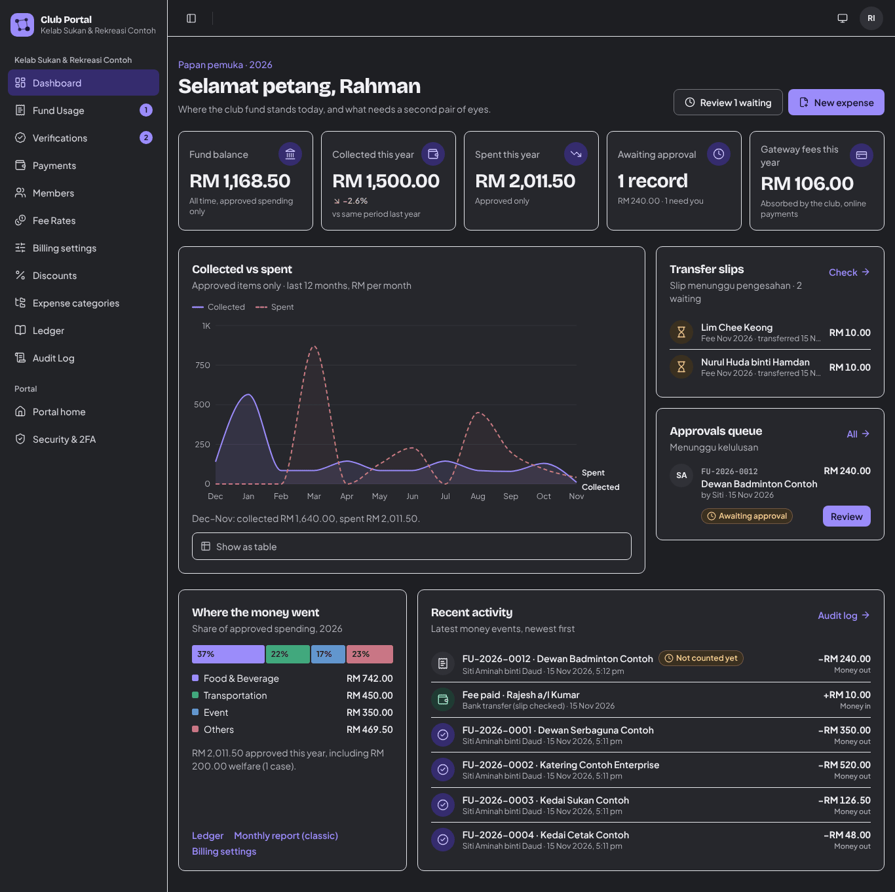

# Club Portal

*Portal yuran kelab: bayar yuran, semak slip, rekod perbelanjaan dengan kelulusan dua orang.*

Club Portal is a self-hosted web app for small staff clubs in Malaysia. Members pay their club fees online (FPX) or by
free bank / DuitNow transfer with a slip, and get a receipt. Committee members record every ringgit spent with
documents, and a second admin has to approve it before it counts. It runs on ordinary cPanel PHP hosting: no Node
process on the server.

<table>
  <tr>
    <td align="center"><br><sub>Member home</sub></td>
    <td align="center"><br><sub>Pay by transfer, no charge</sub></td>
    <td align="center"><br><sub>Official receipt</sub></td>
    <td align="center"><br><sub>Dark theme</sub></td>
  </tr>
</table>



## Features

**For members** (installable web app, Bahasa Melayu by default, English toggle, light/dark theme)
- Home shows the amount due, upcoming fees, recent payments and club-wide totals of where the money went
  (totals only: no payees, documents or other members' names).
- **Review & pay** ("Semak & bayar") with a choice of:
  - **FPX** through the club's gateway (ToyyibPay or Billplz);
  - **bank / DuitNow transfer** ("Pindahan bank / DuitNow"): the page shows the club's account and a `YURAN-{id}`
    reference, the member uploads 1–3 slips (photo or PDF) and the fee shows "Menunggu pengesahan" until a
    treasurer approves it.
- Invoice and official receipt ("Resit rasmi") for every fee, with a print button.
- Payment history by year and **pay ahead** ("Bayar lebih awal") for 1, 3 or 12 months, using the plans the club allows.
- Add to home screen (PWA) with a small install tip.

**For club admins (treasurer, secretary)**
- **Dashboard**: fund balance, collected and spent this year, gateway fees absorbed, a 12-month chart, transfer slips
  and approvals waiting, recent money events.
- **Fund Usage** (expenses and welfare / "kebajikan" contributions) with **maker-checker**: one admin records it with
  invoices, receipts or bank slips, a different admin approves it with a conflict-of-interest declaration (or returns
  it with a reason). Approved records can't be edited; voiding needs two admins. Only approved records count in
  balances and reports.
- **Payment verifications**: check members' transfer slips against the bank statement, approve (the member gets the
  receipt by email) or reject with a reason (the member is emailed and can send a new slip).
- **Billing settings**: which plans members may choose, the default plan, who pays the gateway fee, and the club's
  bank / DuitNow details. A change to the bank details waits for a second admin to approve it.
- Members (add one by one or import CSV, welcome email with a temporary password), fee rates by job level,
  discounts, payments, expense categories.
- **Ledger** with running balance, monthly breakdown and outstanding fees, exported as CSV (Excel-ready) or PDF
  (A4 landscape for the AGM).
- Per-club audit log.

**For the super admin**
- Clubs (including each club's gateway and credentials), administrators, platform statistics and the platform-wide
  audit log. Only the super admin can make someone a club admin.

## Screenshots

| | |
|---|---|
|  |  |
| Fund Usage: every record, its documents and who made / checked it | A record waiting for a second admin, with documents and audit trail |
|  |  |
| Payment verifications: transfer slips to check | Billing settings: a bank details change waiting for a second admin |
|  |  |
| Ledger with CSV / PDF export | Dark theme |

More, with step-by-step instructions, in the [user guide](docs/USER-GUIDE.md). All names, emails, bank details and
amounts in the screenshots are made up.

## Tech stack

- **Backend:** Laravel 13 (PHP 8.4), SQLite by default (MySQL / PostgreSQL via `.env`), database sessions, cache and queue.
- **Front end:** member pages and the main admin pages (dashboard, Fund Usage, verifications) use Inertia 2 + React 18 +
  TypeScript + Tailwind 3, built with Vite. The remaining admin pages, login and installer are Blade with Bootstrap 5
  loaded from jsDelivr.
- **Payments:** ToyyibPay and Billplz behind one gateway interface (per-club choice and credentials), plus manual
  bank / DuitNow transfer.
- **Other:** `pragmarx/google2fa` (TOTP 2FA), `barryvdh/laravel-dompdf` (ledger PDF), Recharts (charts).

## Requirements

- PHP **8.4** (`composer.lock` needs it) with PDO SQLite (the installer checks for `pdo_sqlite` even when the app
  uses MySQL) plus your database's driver, and Composer.
- Node 22 **only to build** the front end (`npm run build`). The server never runs Node.

## Quick start (local development)

```bash
git clone <repo-url> club-portal && cd club-portal
composer install
cp .env.example .env && php artisan key:generate
touch database/database.sqlite
php artisan migrate
php artisan db:seed            # demo data, local/testing only
npm ci && npm run build        # or `npm run dev` while working on the React pages
touch storage/app/.installed   # skip the installer locally
php artisan serve
```

The demo seeder creates a super admin `superadmin@example.com` whose password is `SEED_SUPER_ADMIN_PASSWORD` from
`.env`, or a random one it prints once. There is no well-known default password. It also creates a sample club with
members, fees and Fund Usage records. It refuses to run unless `APP_ENV` is `local` or `testing`.

`composer dev` runs the server, queue worker and log tail together.

## Deploying to cPanel (summary)

Full steps, the production `.env` block and PWA notes are in [docs/RELEASE.md](docs/RELEASE.md).

1. Build from a clean checkout, locally or in CI: `composer install --no-dev -o` and `npm ci && npm run build`.
2. Upload the app with `vendor/` and `public/build/`. Don't upload `node_modules/`, `public/hot`, a local `.env`,
   `database/*.sqlite` or `storage/app/.installed`. The web root must be the app's `public/` folder: point the
   domain's document root at it, or upload the app outside `public_html` and symlink `public_html` to `public/`.
   Then `chmod -R 775 storage bootstrap/cache`.
3. Create the server's `.env`: copy `.env.example` to `.env`, run `php artisan key:generate`, and set
   `APP_ENV=production`, `APP_DEBUG=false`, `APP_URL` (the exact `https://` address) and a random `INSTALL_TOKEN`
   (16+ characters).
4. Fill in the `MAIL_*` SMTP settings (e.g. a cPanel email account). **Without them no email goes out**, including the
   welcome email with each new member's temporary password, receipts and slip rejections.
5. Run `php artisan storage:link` (club logos need it) and **`php artisan migrate --force`**. The sessions and cache
   live in the database, so `/install` returns a 500 error until the tables exist (with SQLite, this also creates
   `database/database.sqlite`).
6. Open `https://<your-domain>/install` straight away. The installer asks for the token, checks requirements (it needs
   the `pdo_sqlite` PHP extension even if you use MySQL), creates the super admin, writes production settings and
   blanks the token.
7. Set `TOYYIBPAY_WEBHOOK_SECRET` to a random value of **at least 32 characters** (and `BILLPLZ_X_SIGNATURE_KEY` if you
   use Billplz); without them every gateway callback is refused. Then run `php artisan config:cache`, and run it
   again after **any** later `.env` change.
8. Raise the PHP upload limits to `upload_max_filesize = 12M` and `post_max_size = 32M` (slips and documents are up to
   10 MB each; 32M fits about 3 full-size documents per save, see RELEASE.md).
9. Add a cron job (cPanel → Cron Jobs, every minute):
   `* * * * * cd /path/to/app && php artisan schedule:run >> /dev/null 2>&1`. It sends the overdue-fee reminders daily at
   08:00. No queue worker is needed.
10. Each release: `php artisan migrate --force`, cache config/routes/views, and bump `CACHE_VERSION` in `public/sw.js`.

> **Before v1.0:** some columns were added by editing existing migrations, so an existing database from an earlier
> build needs `php artisan migrate:fresh`. From v1.0, migrations will be additive only.

## Payments

- **ToyyibPay** and **Billplz** (FPX). The super admin picks each club's gateway and stores its credentials (encrypted);
  `.env` holds global fallbacks. Set `TOYYIBPAY_SANDBOX=true` / `BILLPLZ_SANDBOX=true` for testing.
- A paid ToyyibPay callback is confirmed with ToyyibPay's `getBillTransactions` before the fee is marked paid
  (`TOYYIBPAY_VERIFY_CALLBACK`, on by default). Billplz callbacks are checked with the X-Signature.
- **Gateway fee:** the club chooses whether it absorbs the per-bill fee or members pay it. For ToyyibPay, "member pays"
  stays disabled until `TOYYIBPAY_CHARGE_VERIFIED=true` (after a sandbox check).
- **Bank / DuitNow transfer** costs nothing: members upload a slip and an admin verifies it.
- Fee comparison and advice for committees: [docs/payment-options.md](docs/payment-options.md).

## Security highlights

- **Maker-checker where money moves:** Fund Usage approval and voiding, and bank / DuitNow detail changes, need a
  second admin (the super admin can act as one). Any one club admin can verify a member's transfer slip, but not a
  slip for their own fee: that needs another admin.
- **Own-fee rule:** a club admin can't approve their own slip, mark their own fee paid, or change its amount or
  discount (the super admin is exempt).
- **2FA** (TOTP with recovery codes) for any user; codes can't be reused and the challenge locks after 5 wrong codes.
- **Private, encrypted files:** documents and slips are encrypted at rest with `APP_KEY` on a private disk and served
  only to that club's admins (and a member's own slip); opening or downloading a document is audited. Welfare personal details are encrypted columns.
- **Audit log** of every write, with old/new values, user, IP and user agent.
- Fail-closed webhooks with a per-bill HMAC token, CSP with nonces, rate limits on login, 2FA, password reset,
  installer and uploads, CSV formula-injection protection on exports, and production URLs pinned to `APP_URL`.

**You are responsible for securing your own deployment**: HTTPS only, `APP_DEBUG=false`, a backed-up `APP_KEY`
(without it the stored documents can't be read), regular database and `storage/app/private` backups, and
`TRUSTED_PROXIES` if your host puts a proxy in front of PHP. See [docs/RELEASE.md](docs/RELEASE.md).

To report a security vulnerability, use GitHub's private vulnerability reporting (the repository's **Security** tab →
**Report a vulnerability**). Please don't open a public issue.

## Testing

```bash
php artisan test          # PHPUnit feature and unit tests (SQLite in memory)
npm run typecheck         # tsc --noEmit
npm run build             # production build
```

An end-to-end browser smoke test (Playwright) covers paying online, paying by transfer, Fund Usage approval and slip
verification against a running server: see [tests/e2e/README.md](tests/e2e/README.md).

## Documentation

| Document | What it covers |
|---|---|
| [docs/USER-GUIDE.md](docs/USER-GUIDE.md) | Task-based guide for members, treasurers / club admins and the super admin |
| [docs/RELEASE.md](docs/RELEASE.md) | Release build, cPanel deploy, production `.env`, upload limits, PWA service worker |
| [docs/payment-options.md](docs/payment-options.md) | Gateway fees compared, recommendation for small clubs |
| [docs/option-a-report.md](docs/option-a-report.md) | Build log, review findings and the before-go-live checklist |
| [tests/e2e/README.md](tests/e2e/README.md) | Running the end-to-end smoke test |
| [CHANGELOG.md](CHANGELOG.md) | Changes by release |

## Disclaimer

**This software is provided "as is", without warranty of any kind, express or implied.**

The author(s) of this project accept **no liability** for:

- Any data breaches, unauthorized access, or security incidents arising from your deployment or configuration of this software
- Loss of data, financial loss, or any other damages resulting from the use or misuse of this software
- Security vulnerabilities in third-party dependencies, hosting environments, or integrations (including ToyyibPay and Billplz)
- Any consequences of failing to follow the security guidelines above

By deploying this software, you agree that you are solely responsible for securing your environment, protecting user data, and complying with applicable laws and regulations (including data protection and privacy laws such as PDPA, GDPR, etc.).

This disclaimer does not override any rights you may have under the MIT License.

## License

Licensed under the [MIT License](LICENSE).

## Third-Party Credits

This project builds on open-source libraries. See [CREDITS.md](CREDITS.md) for the direct dependencies (PHP and front end), their licenses, and copyright notices.

Notable licenses in use:

| Package(s) | License |
|---|---|
| Laravel, laravel/ui, laravel/tinker, barryvdh/laravel-dompdf, pragmarx/google2fa, guzzlehttp/guzzle | MIT |
| bacon/bacon-qr-code | BSD-2-Clause |
| dompdf/dompdf, dompdf/php-font-lib | LGPL-2.1 |
| dompdf/php-svg-lib | LGPL-3.0 |
| Bootstrap, Bootstrap Icons, Chart.js (CDN) | MIT |
| React, Inertia, Tailwind CSS, Recharts, Radix UI, Vite | MIT |
| lucide-react | ISC |
| class-variance-authority | Apache-2.0 |

The LGPL-licensed dompdf packages are used unmodified as separate Composer packages. Their complete source code is publicly available and linked in CREDITS.md.

---

Built by [@amirsubhi](https://github.com/amirsubhi), assisted by [Claude Code](https://claude.ai/code).
