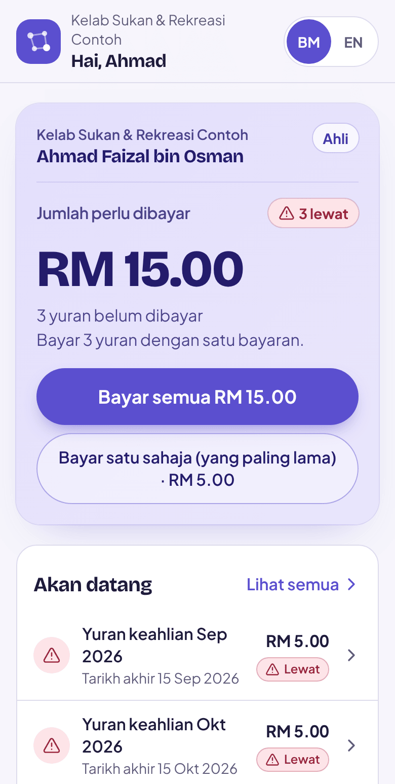
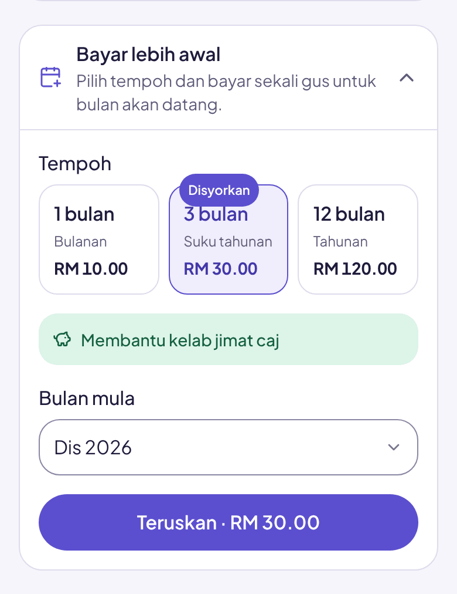
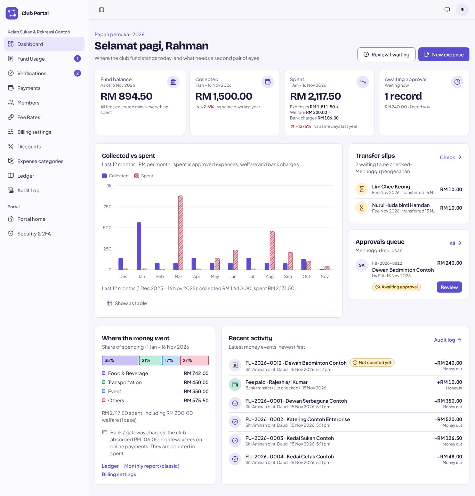

# Club Portal user guide

Short, task-based instructions. Member pages are in Bahasa Melayu by default (switch with **BM / EN** at the top), so
their labels are quoted in BM as they appear. Admin pages are in English. Everyone in the screenshots is fictional.

- [Members](#members): [pay by FPX](#pay-by-fpx) · [pay by bank transfer](#pay-by-bank-transfer--duitnow) ·
  [pay all at once](#pay-all-open-fees-at-once-bayar-semua) · [receipts](#view-an-invoice-or-receipt) · [pay ahead](#pay-ahead) · [install as an app](#install-as-an-app-pwa) · [2FA](#turn-on-two-factor-authentication)
- [Treasurer / club admin](#treasurer--club-admin): [verify slips](#verify-transfer-slips) ·
  [record an expense or welfare case](#record-an-expense-or-welfare-case) · [approve a record](#approve-someone-elses-record) ·
  [bank details](#change-the-clubs-bank-details) · [plans and gateway fee](#billing-plans-and-gateway-fee) ·
  [bank charges](#bank-and-gateway-charges) · [ledger and the AGM](#the-ledger-and-the-agm) · [reminders](#overdue-reminders) ·
  [job levels](#set-up-job-levels-before-fee-rates)
- [Super admin](#super-admin): [install](#install-the-app) · [create a club](#create-a-club) · [grant club admin](#make-someone-a-club-admin)

---

## Members

Log in with the email and temporary password from your welcome email. The first time, the app asks you to **choose
your own password** (**Pilih kata laluan anda sendiri**): type the temporary password, then your new one twice. It
needs at least 12 characters; a few ordinary words together is easiest to remember. You can change it again later
at `/password/change`.

If you type a wrong password many times (10 in a row), signing in to your account pauses for 15 minutes and you get
an email about it. Wait and try again, or use **Lupa kata laluan?** to reset your password straight away.

**Utama** (home) shows:

- your membership card with **Jumlah perlu dibayar**: what you owe now, with a **Bayar RM …** button for the oldest
  fee and **Invois** (or **Bayar semua RM …** when more than one fee is open, see below);
- **Akan datang**: fees still open; **Aktiviti terkini**: your recent payments;
- **Ke mana wang anda pergi**: how much the club collected and spent this year (expenses + welfare + bank charges),
  by category in BM (totals only);
- **Akaun saya**: theme (system / light / dark), **Keselamatan & 2FA** and **Log keluar**.

**Bayaran** (bottom bar) lists all your fees by year.

 

### Pay by FPX

1. On **Utama**, tap **Bayar RM …** (or open a fee and choose to pay). The **Semak & bayar** page shows what the fee
   is for, the member, the club and the total.
2. Under **Pilih cara bayar**, keep **FPX (perbankan dalam talian)**.
3. Tap **Bayar RM …**. You go to ToyyibPay or Billplz, pick your bank and pay there. Don't close the window until it
   finishes.
4. You come back to a result page: **Berjaya** (paid), **Dalam proses** (still waiting for the gateway; the page checks
   again by itself) or **Bayaran belum diterima**. The fee is marked paid only when the gateway confirms it to the
   server, and the receipt is emailed to you.

If the club passes the gateway fee to members, the review page shows it as a separate line before you pay.

 

### Pay by bank transfer / DuitNow

No gateway charge. Shown only when the club has published its bank details.

1. On **Semak & bayar**, choose **Pindahan bank / DuitNow**.
2. Transfer the exact amount to the account shown (tap **Salin** to copy the account number or DuitNow ID).
3. Type the reference shown under **Rujukan (taip dalam pindahan)**, e.g. `YURAN-179`, in your bank's reference or
   note field, so the treasurer can match it.
4. Under **Hantar slip pindahan**, add 1 to 3 files (photo or PDF, up to 10 MB each). On a phone, **Ambil gambar**
   opens the camera.
5. Check **Tarikh pindahan**, optionally fill in **No. rujukan bank (pilihan)**, and tap **Hantar slip**.

 

The fee now shows **Menunggu pengesahan** / **Disemak** and is no longer counted as owed. **Don't pay it again.**
When the treasurer approves the slip, the fee becomes paid and the receipt is emailed to you. If the slip is
rejected you get an email with the reason, and the fee page shows **Slip anda belum diterima**: send the right slip or
pay online.

If you started an FPX payment for the same fee earlier, the page warns you: if money already left your account, wait
for that payment instead of transferring as well.

 

### Pay all open fees at once (Bayar semua)

When more than one fee is open (pending or overdue), **Utama** shows **Bayar semua RM …** with the total, and
**Bayar satu sahaja (yang paling lama)** for just the oldest fee. Open fees are always listed oldest first.

- **Semak & bayar semua** lists every fee in the set and the total.
- **FPX:** one bill, so one gateway charge for the whole set. When the gateway confirms it, every fee is marked paid
  together and the receipt has one line per fee.
- **Bank transfer:** one transfer and one slip for the whole set, with the reference `YURAN-G…` shown on the page.
  The treasurer approves or rejects the set together.
- If a fee changes after you opened the page (for example the treasurer edits an amount), you are asked to check the
  new total before paying. A fee already being checked from an earlier slip is left out.

 

### View an invoice or receipt

Open any fee from **Utama** or **Bayaran**. An unpaid fee shows its invoice; a paid fee shows the **Resit rasmi**
(official receipt) with the payment method (FPX with the transaction ID, or **Pindahan bank / DuitNow**). Tap
**Cetak** to print or save it as PDF.

 

### Pay ahead

On **Bayaran**, open **Bayar lebih awal** at the bottom:

1. Under **Tempoh**, pick 1, 3 or 12 months (only the plans your club allows; the club's default plan is marked
   **Disyorkan** and pre-selected). Longer plans mean fewer bills, so less in gateway charges for the club.
2. Choose **Bulan mula** (next month or later) and tap **Teruskan · RM …**.
3. A new invoice is created; pay it by FPX or transfer as above.

 

### Install as an app (PWA)

Club Portal can sit on your phone's home screen like an app (it is still the same website).

- **Android / Chrome:** on **Utama**, the **Pasang di skrin utama** card has a **Pasang** button. If you closed it,
  use the browser menu's "Install app" / "Add to Home screen".
- **iPhone / Safari:** tap the Share button, then **Tambah ke Skrin Utama** ("Add to Home Screen"). In-app browsers
  (WhatsApp, Facebook) can't do this: open the link in Safari first.

### Turn on two-factor authentication

**Akaun saya → Keselamatan & 2FA** (admins: **Security & 2FA** in the sidebar). Confirm your password, tap
**Enable 2FA**, scan the QR code with an authenticator app (Google Authenticator, Microsoft Authenticator, etc.) and
enter the 6-digit code. **Save the recovery codes** shown once: each one logs you in once if you lose your phone.
After 5 wrong codes the challenge locks for 15 minutes.

2FA is optional for members. **Admins (club admins and the super admin) must turn it on:** until they do, every admin
page opens the Security page instead, with a notice. To turn 2FA off you need your password **and** a code from the
app (or one recovery code). An admin who turns it off is asked to set it up again straight away.

---

## Treasurer / club admin

Admins log in at the same address. A new admin first chooses their own password (as members do), then turns on
2FA ([see above](#turn-on-two-factor-authentication)): the admin pages open once 2FA is on. After that they land on a page listing their clubs; open a club's **Dashboard**. The sidebar has **Dashboard**, **Fund Usage**,
**Verifications**, **Payments**, **Members**, **Fee Rates**, **Job levels**, **Billing settings**, **Discounts**, **Expense
categories**, **Ledger**, **Audit Log**, **Portal home** (back to the list of your clubs) and **Security & 2FA**, the
same on every admin page. To see your own member view (admins pay fees too), use **Member view** in the account menu
(your initials, top right). The screen icon next to it switches the theme (light, dark or system).

The **Dashboard** shows the fund balance today (everything collected minus everything approved as spent), collected
and spent this year (spent = expenses + welfare + bank charges, with the split), records awaiting approval, a
12-month collected vs spent chart (**Show as table** for the numbers), transfer slips and approvals waiting for you,
and recent money events. Every figure says which period it covers, and the same figures appear on Fund Usage, the
Ledger and the member card.

**Two-person rule.** Anything that moves or redirects money needs a second admin: approving a Fund Usage record,
voiding one, changing the bank details, and approving a slip for your own fee. You can never check your own work or
your own fee.

### Verify transfer slips

1. Open **Verifications** (the badge shows how many are waiting). Each card shows the member, fee, amount, transfer
   date, the reference to look for (`YURAN-…`) and the member's bank reference, with the slip beside it (click to open).
2. Find the money in the club's bank statement.
3. **Approve**: set **Date received** (when the money reached the club's account), optionally a **Bank reference**,
   and confirm. The fee is marked paid by bank transfer and the member gets the receipt by email.
4. Or **Reject** with a reason the member will read (e.g. "Amount is RM5 short"). The member is emailed and can send a
   new slip.

**Recently handled** lists past decisions. You can't approve a slip for your own fee; another admin must.

A **Bayar semua** slip shows as one card with every fee it covers and the total (also one row on the dashboard).
Approving or rejecting it moves all the fees together. If one of them was paid online in the meantime, the card says
so and shows the amount to refund; the rest can still be approved.

### Record an expense or welfare case

1. **Fund Usage → New expense** (or **New welfare case** for a "sumbangan kebajikan").
2. Fill in the category, payee, description, amount, invoice/bill number, invoice date, **Date paid** (when the money
   left the account) and the **Meeting minute ref.** if the committee approved it in a meeting. Under each date
   field the picked date is written out (e.g. "16 Nov 2026"), so day and month can't be mixed up. If something is missing when you submit, a list of what to fix
   appears at the top and the cursor moves to it.
3. Attach the documents (PDF, JPG, PNG or WebP, up to 10 MB each, at most 10 per record) and set each one's kind
   (Invoice, Receipt, Bank slip, Acknowledgement, Other). Files are stored encrypted and only club admins can open them.
4. **Save draft** to finish later, or **Submit for approval**. Once submitted, documents are locked.

The list shows each record's status: draft, **Awaiting approval**, **Returned** (fix it and submit again), **Approved**
or **Void**. Only approved records count towards balances, the member summary and reports.

**Welfare cases** also ask for the beneficiary member, the deceased or affected person, the relationship and who was
paid (next of kin), and use **Date approved by committee** (required) in place of the invoice date. These details are stored encrypted and shown to admins only. Tick **Death certificate sighted (not
uploaded)** and record who saw it and when, instead of uploading the certificate. Upload proof of payment (bank slip
or signed acknowledgement); it is needed to submit unless the certificate was sighted. Don't type personal details
in the description: descriptions appear in the ledger and audit log.

 

### Approve someone else's record

1. Open the record from **Fund Usage** (the **Awaiting my approval** tab) or the dashboard's **Approvals queue**.
2. Check the amount, payee and every document. The approval rail shows who prepared it and that it is waiting for a
   second admin; the **Audit trail** shows each step.
3. **Approve RM …** and tick the declaration that you have no conflict of interest (you are not the payee, the
   beneficiary or a relative, and you checked the documents). The declaration is logged.
4. Or **Return** it with a reason; the maker fixes it and submits again.

You can't approve a record you recorded, or a welfare case where you are the beneficiary. To cancel an approved
record, one admin uses **Void** with a reason and a different admin confirms it; voided records stay visible for audit.

### Change the club's bank details

Members pay into whatever these say, so a change needs a second admin.

1. **Billing settings → Bank transfer / DuitNow**: edit the bank name, account holder, account number and/or DuitNow
   ID, then **Save billing settings**.
2. The change is held. Members keep seeing the current details, and every club admin is emailed.
3. Another club admin (or the super admin) opens **Billing settings**, compares **Now (members see)** with
   **Requested** and clicks **Approve new details**. The requester can't approve their own change, only **Cancel my
   request**; other admins can also **Cancel this change**.

Switching **Offer bank transfer / DuitNow to members** off takes effect at once (no approval needed).

### Billing plans and gateway fee

Also on **Billing settings**:

- **Billing plans members can choose**: monthly, quarterly and/or yearly for paying ahead, and the **Default plan**
  that is pre-selected. Yearly or quarterly billing means fewer gateway charges.
- **Gateway fee**: **Club absorbs it** (members pay the fee amount only) or **Member pays it** (shown on the review page
  and added to what they pay). For ToyyibPay clubs "Member pays it" stays disabled until it has been checked in the
  ToyyibPay sandbox and enabled on the server.
- **Gateway fee per bill (RM)**: what your gateway plan charges per bill (e.g. RM1.00). Used for the review page,
  savings hints and the dashboard's fee total; the gateway applies its own fee.

See [payment-options.md](payment-options.md) for a comparison of charges.

### Bank and gateway charges

When the club absorbs the gateway fee, each online payment's charge counts as spending: it appears in **Spent** as
**Bank charges** (dashboard, Fund Usage, member card) and as one **Bank / gateway charges** row per month in the
ledger. You don't record these yourself.

Record a charge by hand, as a normal expense in a **Bank charges** category (create it under **Expense categories**
if your club doesn't have it), when:

- the bank charges the club something the portal can't see (monthly account fee, DuitNow or IBG charges); or
- you **reverted a fee that was paid online**: its gateway charge leaves the figures while the fee is not paid, and
  counts again if you mark the fee paid by hand. But if the member then settles it by transfer slip or a new online
  bill, that payment replaces the earlier charge (none for a slip, the new bill's own charge), so the first gateway
  charge is no longer counted. The gateway still kept it: record it as a bank-charges expense with the gateway
  statement as the document.

Each category can have a **Name in Bahasa Melayu** (Expense categories page); members see that name on their
"Ke mana wang anda pergi" card, and the English name when it is empty.

### The ledger and the AGM

1. **Ledger**: choose **This year**, **Last 12 months** or **Custom dates** (up to 24 months).
2. The **Opening balance** is worked out from the records (everything collected minus everything approved as spent
   before the start date), so it matches the dashboard. **Set manually** overrides it, e.g. with the balance from
   last year's audited accounts; the page and the exports then mark it "(diubah secara manual)" and show what the
   records say.
3. Read the summary tiles (money in, money out with the expenses / welfare / bank charges split, closing balance),
   **Month by month** (**Show as chart** for a chart) and the transactions with a running balance. **Fees not yet
   received** lists open fees; they are not in the balance until paid.
4. **Export CSV** (opens in Excel / Google Sheets) or **Export PDF** (A4 landscape for the AGM). Both use the same
   period and opening balance as the page.

**Which figure to quote at the AGM.** Use the **closing balance** for the financial year (**This year**, or **Custom
dates** for your club's year), exported as PDF. If last year's accounts were audited, set the opening balance
manually to the audited figure and say so ("opening balance per audited accounts"); the closing balance is then
that figure plus this year's money in minus money out. If you don't set it, quote the computed figures: they are
the same ones the dashboard and members see.

**Dates differ from the bank statement.** Fees paid online are dated when the gateway confirmed the payment, but the
gateway pays the club later (often the next working day, in batches, net of its fees for some plans). Transfers are
dated with the **Date received** you entered when approving the slip. So a month-end balance can differ from the bank
statement by payments still in transit; match them by the bill reference or `YURAN-…` reference, not by date.

### Overdue reminders

Every day at **08:00 Malaysia time** the portal marks fees past their due date as overdue and emails each member a
reminder. This needs the server's cron job and `APP_TIMEZONE=Asia/Kuala_Lumpur` (set by the installer; see
[INSTALL.md](INSTALL.md)). Without the time zone it runs at 08:00 UTC, which is 4 pm in Malaysia.

### Set up job levels before fee rates

Each club has its own **job levels** (tahap jawatan): every member is on one, and the monthly fee is set per level. A
new club starts with one level, **Ahli**, so a club where everyone pays the same needs nothing more. To charge
different amounts (for example by grade), set the levels up first, then the fee rates, then add members:

1. **Job levels** (sidebar, next to Fee Rates; also linked from the Fee Rates page). **Add Job Level** with a name
   such as "Pegawai" or "Staf Sokongan". It goes last in lists unless you give an **Order** number (lower comes
   first). Rename **Ahli** too if you like.
2. **Fee Rates → Set New Rates**: one monthly amount for each active level.
3. **Members**: pick the level for each member (or import a CSV; see below).

Each level gets a short **code** made from its first name (`pegawai`, `staf_sokongan`), shown on the Job levels page.
The code never changes, so a renamed level shows its new name everywhere (members, fee rates, dashboards). Two
levels of one club can't share a name (capitals don't count).

**Retire a level** with **Deactivate**: it is no longer offered for new members or new fee rates, but members already on
it keep it (and keep paying its rate) until you move them, and it still shows by name. **Reactivate** brings it back.
**Delete** (the bin) is offered only for a level that no member and no fee rate (current or past) is on; a club always
keeps at least one active level. Every add, rename, reorder, deactivation and deletion is in the club's **Audit Log**.

### Other admin tasks

- **Members**: add a member (they get a welcome email with a temporary password, which they replace at their first
  sign-in) or **Import** a CSV (template on the
  import page; up to 1,000 rows). Emails are matched without regard to capitals, so `Ali@club.my` is refused when
  `ali@club.my` already has an account; a CSV saved by Excel on Windows (accented names such as "José") is read
  correctly. The `job_level` column takes one of the club's active [job levels](#set-up-job-levels-before-fee-rates)
  by name or by code, in any case (`Pegawai`, `pegawai`); the import page lists them and the template uses one.
  Club admins can't add or change club admins; only the super admin can.
  **Removing** a member only takes them out of the club: their fees and payments stay (shown as theirs, or "Former
  member" if the account is deleted later), so the fund figures, ledger and AGM history don't change. To stop
  someone being billed while keeping them listed, set them inactive instead.
- **Fee Rates**: monthly fee per active [job level](#set-up-job-levels-before-fee-rates). **Discounts**: fixed or
  percentage discounts.
- **Payments**: all fees, generate fee records, mark a fee paid by hand (not your own). On a phone the status shows
  under the member's name and the table scrolls sideways for the rest.
- **Audit Log**: every change in the club, who made it and when.

---

## Super admin

### Install the app

The full first-install steps (server requirements, `.env`, `migrate --force`, email, cron, upload limits, MySQL,
backups and troubleshooting) are in [INSTALL.md](INSTALL.md). The installer itself works like this:

1. With `.env` ready and `php artisan migrate --force` done ([INSTALL.md steps 5–6](INSTALL.md#step-5-create-env)),
   open `https://<your-domain>/install`. **Club Portal Setup** checks PHP, the PDO extension for your database (MySQL / MariaDB
   or SQLite) and that `storage/` and `.env` are writable.
2. Enter the **INSTALL_TOKEN from your .env**, the application name and URL (the exact `https://` address members will
   use), and the super admin's name, email and a strong password (12+ characters with upper and lower case, numbers
   and symbols).
3. **Install Application** runs the migrations, creates the super admin, writes production settings and blanks the
   token. The installer can't run again afterwards.

Then turn on 2FA for your account and finish the rest of [INSTALL.md](INSTALL.md#step-8-email-smtp) (email, webhook
secret, upload limits, `config:cache`, cron). The ToyyibPay webhook secret lives in `.env`; the Billplz X-Signature
key goes in `.env` or per club (club settings).

### Create a club

**Clubs → New Club**: name, email, logo, and the payment gateway (ToyyibPay or Billplz) with that club's credentials
(stored encrypted; leave empty to use the global ones in `.env`). The club starts with one job level, **Ahli**. Then,
from the club's pages, set up its [**Job levels**](#set-up-job-levels-before-fee-rates), **Fee Rates**, **Expense
categories** and **Billing settings**, and add members.

On **Statistics**, "Members by job level" adds up levels with the same name across clubs ("Manager" in two clubs is
one bar), since each club names its own levels.

### Make someone a club admin

Only the super admin can grant the club-admin role:

- **Members → Add member** for the club and set **Club Role** to **Admin**; or
- edit an existing member of the club and change the role to Admin.

Grants are audited and emailed to the club's admins. Give each club at least two admins so there is always a second
person to approve. **Administrators** lists all admin accounts and lets you add another super admin; the last super
admin can't be demoted or removed.

**Statistics** and **Audit Log** (super admin section of the sidebar) cover all clubs.
