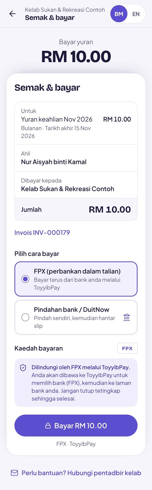
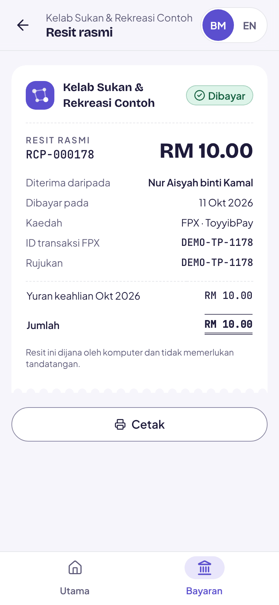
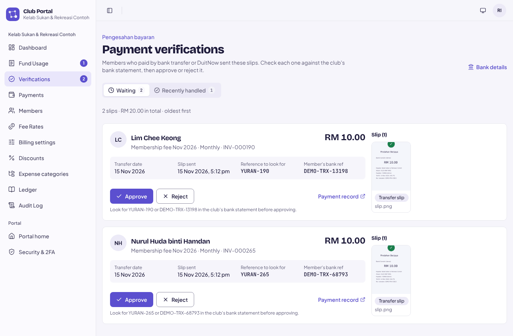
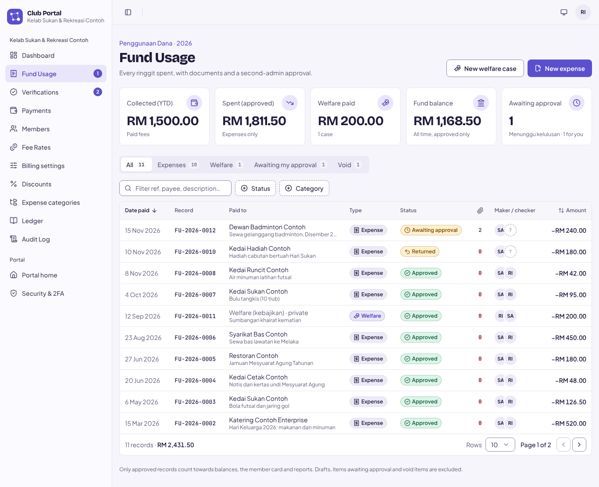
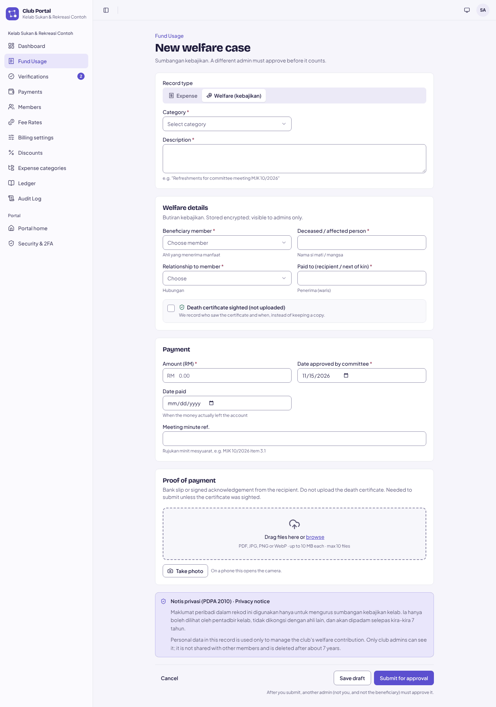
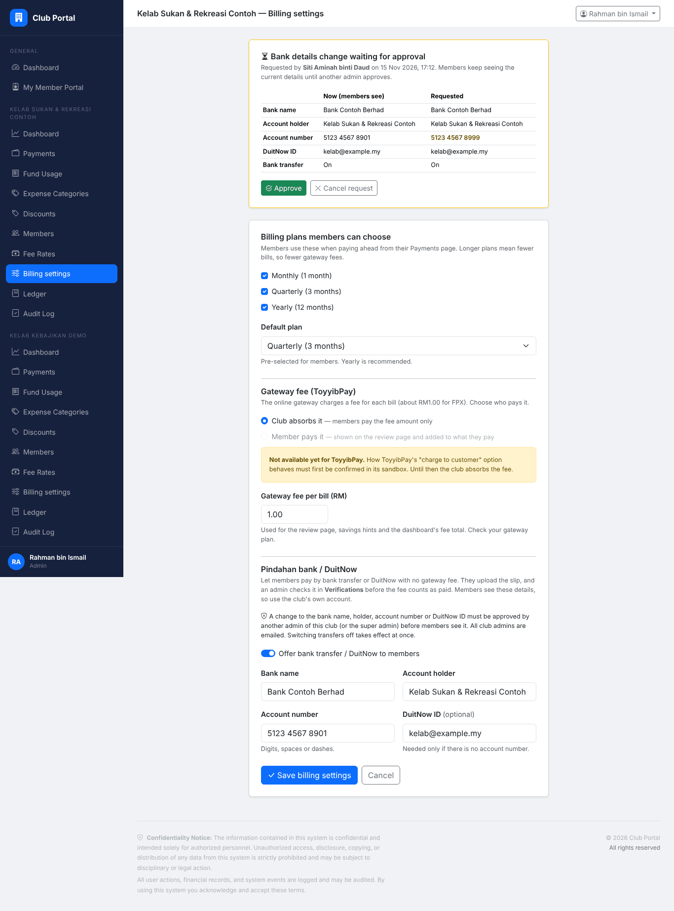
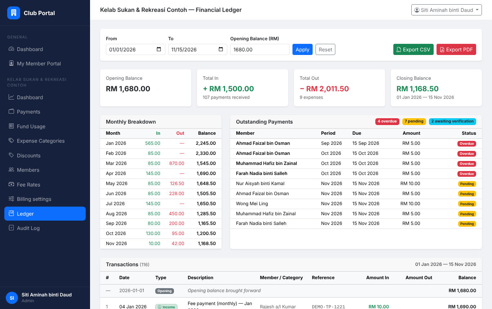
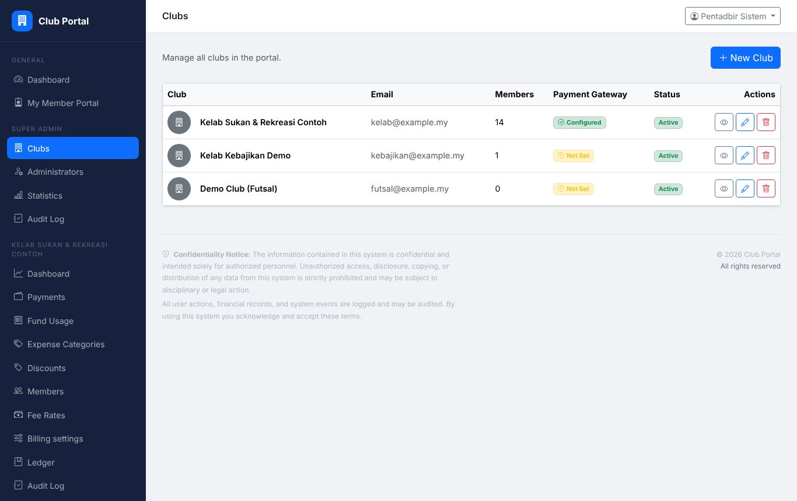

# Club Portal user guide

Short, task-based instructions. Member pages are in Bahasa Melayu by default (switch with **BM / EN** at the top), so
their labels are quoted in BM as they appear. Admin pages are in English. Everyone in the screenshots is fictional.

- [Members](#members): [pay by FPX](#pay-by-fpx) · [pay by bank transfer](#pay-by-bank-transfer--duitnow) ·
  [receipts](#view-an-invoice-or-receipt) · [pay ahead](#pay-ahead) · [install as an app](#install-as-an-app-pwa) · [2FA](#turn-on-two-factor-authentication)
- [Treasurer / club admin](#treasurer--club-admin): [verify slips](#verify-transfer-slips) ·
  [record an expense or welfare case](#record-an-expense-or-welfare-case) · [approve a record](#approve-someone-elses-record) ·
  [bank details](#change-the-clubs-bank-details) · [plans and gateway fee](#billing-plans-and-gateway-fee) · [ledger](#export-the-ledger)
- [Super admin](#super-admin): [install](#install-the-app) · [create a club](#create-a-club) · [grant club admin](#make-someone-a-club-admin)

---

## Members

Log in with the email and temporary password from your welcome email. **Utama** (home) shows:

- **Jumlah perlu dibayar**: what you owe now, with a **Bayar RM …** button for the oldest fee and **Invois**;
- **Akan datang**: fees still open; **Aktiviti terkini**: your recent payments;
- **Ke mana wang anda pergi**: how much the club collected and spent this year, by category (totals only);
- **Akaun saya**: theme (system / light / dark), **Keselamatan & 2FA** and **Log keluar**.

**Bayaran** (bottom bar) lists all your fees by year.

 

### Pay by FPX

1. On **Utama**, tap **Bayar RM …** (or open a fee and choose to pay). The **Semak & bayar** page shows what the fee
   is for, the member, the club and the total.
2. Under **Pilih cara bayar**, keep **FPX (perbankan dalam talian)**.
3. Tap **Bayar RM …**. You go to ToyyibPay or Billplz, pick your bank and pay there. Don't close the window until it
   finishes.
4. You come back to a result page: **Berjaya** (paid), **Dalam proses** (still waiting for the gateway; the page checks
   again by itself) or **Bayaran belum diterima**. The fee is marked paid only when the gateway confirms it to the
   server, and the receipt is emailed to you.

If the club passes the gateway fee to members, the review page shows it as a separate line before you pay.

 

### Pay by bank transfer / DuitNow

No gateway charge. Shown only when the club has published its bank details.

1. On **Semak & bayar**, choose **Pindahan bank / DuitNow**.
2. Transfer the exact amount to the account shown (tap **Salin** to copy the account number or DuitNow ID).
3. Type the reference shown under **Rujukan (taip dalam pindahan)**, e.g. `YURAN-179`, in your bank's reference or
   note field, so the treasurer can match it.
4. Under **Hantar slip pindahan**, add 1 to 3 files (photo or PDF, up to 10 MB each). On a phone, **Ambil gambar**
   opens the camera.
5. Check **Tarikh pindahan**, optionally fill in **No. rujukan bank (pilihan)**, and tap **Hantar slip**.

 

The fee now shows **Menunggu pengesahan** / **Disemak** and is no longer counted as owed. **Don't pay it again.**
When the treasurer approves the slip, the fee becomes paid and the receipt is emailed to you. If the slip is
rejected you get an email with the reason, and the fee page shows **Slip anda belum diterima**: send the right slip or
pay online.

If you started an FPX payment for the same fee earlier, the page warns you: if money already left your account, wait
for that payment instead of transferring as well.

 

### View an invoice or receipt

Open any fee from **Utama** or **Bayaran**. An unpaid fee shows its invoice; a paid fee shows the **Resit rasmi**
(official receipt) with the payment method (FPX with the transaction ID, or **Pindahan bank / DuitNow**). Tap
**Cetak** to print or save it as PDF.

 

### Pay ahead

On **Bayaran**, open **Bayar lebih awal** at the bottom:

1. Under **Tempoh**, pick 1, 3 or 12 months (only the plans your club allows; the club's default plan is marked
   **Disyorkan** and pre-selected). Longer plans mean fewer bills, so less in gateway charges for the club.
2. Choose **Bulan mula** (next month or later) and tap **Teruskan · RM …**.
3. A new invoice is created; pay it by FPX or transfer as above.

 

### Install as an app (PWA)

Club Portal can sit on your phone's home screen like an app (it is still the same website).

- **Android / Chrome:** on **Utama**, the **Pasang di skrin utama** card has a **Pasang** button. If you closed it,
  use the browser menu's "Install app" / "Add to Home screen".
- **iPhone / Safari:** tap the Share button, then **Tambah ke Skrin Utama** ("Add to Home Screen"). In-app browsers
  (WhatsApp, Facebook) can't do this: open the link in Safari first.

### Turn on two-factor authentication

**Akaun saya → Keselamatan & 2FA** (admins: **Security & 2FA** in the sidebar). Confirm your password, tap
**Enable 2FA**, scan the QR code with an authenticator app (Google Authenticator, Microsoft Authenticator, etc.) and
enter the 6-digit code. **Save the recovery codes** shown once: each one logs you in once if you lose your phone.
After 5 wrong codes the challenge locks for 15 minutes.

---

## Treasurer / club admin

Admins log in at the same address and land on a page listing their clubs; open a club's **Dashboard**. The sidebar has **Dashboard**, **Fund Usage**,
**Verifications**, **Payments**, **Members**, **Fee Rates**, **Billing settings**, **Discounts**, **Expense
categories**, **Ledger** and **Audit Log** (the classic pages use a slightly different sidebar). **Portal home** goes
back to the list of your clubs. To see your own member view (admins pay fees too), use **Member view** in the account
menu (your initials, top right) or **My Member Portal** in the classic sidebar.

The **Dashboard** shows the fund balance (all time, approved spending only), collected and spent this year, records
awaiting approval, gateway fees the club absorbed, a 12-month collected vs spent chart (**Show as table** for the
numbers), transfer slips and approvals waiting for you, and recent money events.

**Two-person rule.** Anything that moves or redirects money needs a second admin: approving a Fund Usage record,
voiding one, changing the bank details, and approving a slip for your own fee. You can never check your own work or
your own fee.

### Verify transfer slips

1. Open **Verifications** (the badge shows how many are waiting). Each card shows the member, fee, amount, transfer
   date, the reference to look for (`YURAN-…`) and the member's bank reference, with the slip beside it (click to open).
2. Find the money in the club's bank statement.
3. **Approve**: set **Date received** (when the money reached the club's account), optionally a **Bank reference**,
   and confirm. The fee is marked paid by bank transfer and the member gets the receipt by email.
4. Or **Reject** with a reason the member will read (e.g. "Amount is RM5 short"). The member is emailed and can send a
   new slip.

**Recently handled** lists past decisions. You can't approve a slip for your own fee; another admin must.

### Record an expense or welfare case

1. **Fund Usage → New expense** (or **New welfare case** for a "sumbangan kebajikan").
2. Fill in the category, payee, description, amount, invoice/bill number, invoice date, **Date paid** (when the money
   left the account) and the **Meeting minute ref.** if the committee approved it in a meeting.
3. Attach the documents (PDF, JPG, PNG or WebP, up to 10 MB each, at most 10 per record) and set each one's kind
   (Invoice, Receipt, Bank slip, Acknowledgement, Other). Files are stored encrypted and only club admins can open them.
4. **Save draft** to finish later, or **Submit for approval**. Once submitted, documents are locked.

The list shows each record's status: draft, **Awaiting approval**, **Returned** (fix it and submit again), **Approved**
or **Void**. Only approved records count towards balances, the member summary and reports.

**Welfare cases** also ask for the beneficiary member, the deceased or affected person, the relationship and who was
paid (next of kin), and use **Date approved by committee** (required) in place of the invoice date. These details are stored encrypted and shown to admins only. Tick **Death certificate sighted (not
uploaded)** and record who saw it and when, instead of uploading the certificate. Upload proof of payment (bank slip
or signed acknowledgement); it is needed to submit unless the certificate was sighted. Don't type personal details
in the description: descriptions appear in the ledger and audit log.

 

### Approve someone else's record

1. Open the record from **Fund Usage** (the **Awaiting my approval** tab) or the dashboard's **Approvals queue**.
2. Check the amount, payee and every document. The approval rail shows who prepared it and that it is waiting for a
   second admin; the **Audit trail** shows each step.
3. **Approve RM …** and tick the declaration that you have no conflict of interest (you are not the payee, the
   beneficiary or a relative, and you checked the documents). The declaration is logged.
4. Or **Return** it with a reason; the maker fixes it and submits again.

You can't approve a record you recorded, or a welfare case where you are the beneficiary. To cancel an approved
record, one admin uses **Void** with a reason and a different admin confirms it; voided records stay visible for audit.

### Change the club's bank details

Members pay into whatever these say, so a change needs a second admin.

1. **Billing settings → Pindahan bank / DuitNow**: edit the bank name, account holder, account number and/or DuitNow
   ID, then **Save billing settings**.
2. The change is held. Members keep seeing the current details, and every club admin is emailed.
3. Another club admin (or the super admin) opens **Billing settings**, compares **Now (members see)** with
   **Requested** and clicks **Approve**. Anyone, including the requester, can **Cancel request**.

Switching **Offer bank transfer / DuitNow to members** off takes effect at once (no approval needed).

### Billing plans and gateway fee

Also on **Billing settings**:

- **Billing plans members can choose**: monthly, quarterly and/or yearly for paying ahead, and the **Default plan**
  that is pre-selected. Yearly or quarterly billing means fewer gateway charges.
- **Gateway fee**: **Club absorbs it** (members pay the fee amount only) or **Member pays it** (shown on the review page
  and added to what they pay). For ToyyibPay clubs "Member pays it" stays disabled until it has been checked in the
  ToyyibPay sandbox and enabled on the server.
- **Gateway fee per bill (RM)**: what your gateway plan charges per bill (e.g. RM1.00). Used for the review page,
  savings hints and the dashboard's fee total; the gateway applies its own fee.

See [payment-options.md](payment-options.md) for a comparison of charges.

### Export the ledger

1. **Ledger**: set **From** and **To** (up to 24 months) and the **Opening Balance (RM)**, i.e. the club's balance
   before that date, then **Apply**.
2. Read the summary, **Monthly Breakdown**, **Outstanding Payments** and the full transaction list with a running
   balance.
3. **Export CSV** (opens in Excel / Google Sheets) or **Export PDF** (A4 landscape for the AGM). Both use the same
   filters.

### Other admin tasks

- **Members**: add a member (they get a welcome email with a temporary password) or **Import** a CSV (template on the
  import page; up to 1,000 rows). Club admins can't add or change club admins; only the super admin can.
- **Fee Rates**: monthly fee per job level. **Discounts**: fixed or percentage discounts.
- **Payments**: all fees, generate fee records, mark a fee paid by hand (not your own).
- **Audit Log**: every change in the club, who made it and when.

---

## Super admin

### Install the app

1. Prepare the server as in [RELEASE.md](RELEASE.md) step 3: create `.env` with the app key, `APP_URL` and a random
   `INSTALL_TOKEN` of at least 16 characters, then run `php artisan storage:link` and **`php artisan migrate --force`**
   (without the tables `/install` shows a server error).
2. Open `https://<your-domain>/install` straight after the upload. **Club Portal Setup** checks PHP, SQLite and that
   `storage/` and `.env` are writable.
3. Enter the **INSTALL_TOKEN from your .env**, the application name and URL (the exact `https://` address members will
   use), and the super admin's name, email and a strong password (12+ characters with upper and lower case, numbers
   and symbols).
4. **Install Application** runs the migrations, creates the super admin, writes production settings and blanks the
   token. The installer can't run again afterwards.

Then turn on 2FA for your account, and follow [RELEASE.md](RELEASE.md) for the webhook secret, email settings,
cron job and upload limits. The ToyyibPay webhook secret lives in `.env`; the Billplz X-Signature key goes in `.env`
or per club (club settings).

### Create a club

**Clubs → New Club**: name, email, logo, and the payment gateway (ToyyibPay or Billplz) with that club's credentials
(stored encrypted; leave empty to use the global ones in `.env`). Then, from the club's pages, set **Fee Rates**,
**Expense categories** and **Billing settings**, and add members.

### Make someone a club admin

Only the super admin can grant the club-admin role:

- **Members → Add member** for the club and set **Club Role** to **Admin**; or
- edit an existing member of the club and change the role to Admin.

Grants are audited and emailed to the club's admins. Give each club at least two admins so there is always a second
person to approve. **Administrators** lists all admin accounts and lets you add another super admin; the last super
admin can't be demoted or removed.

**Statistics** and **Audit Log** (super admin section of the sidebar) cover all clubs.
