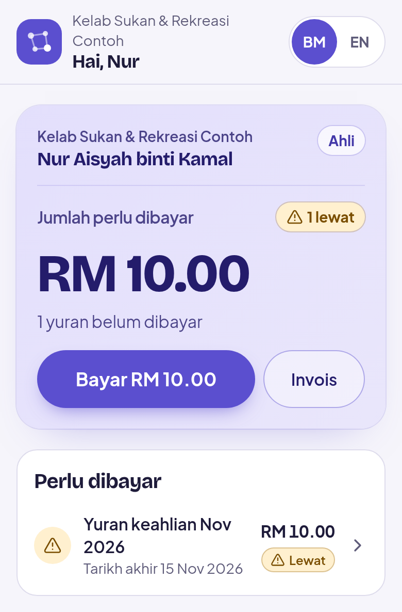
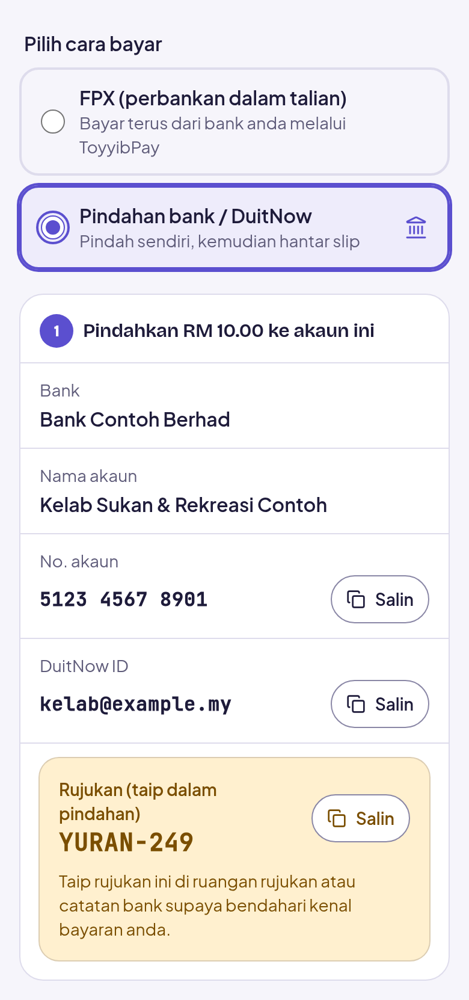
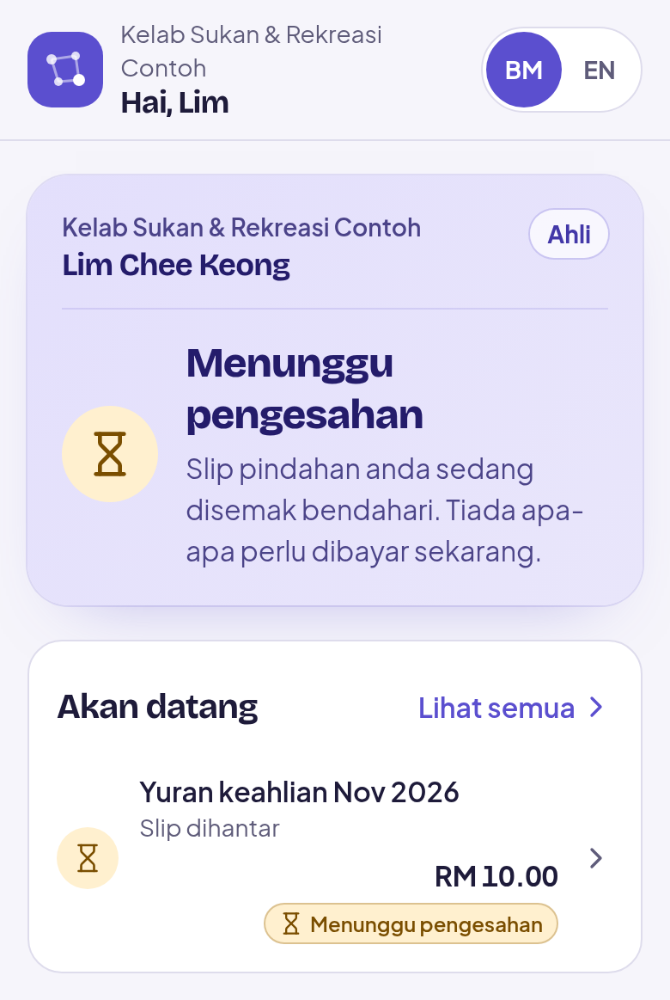
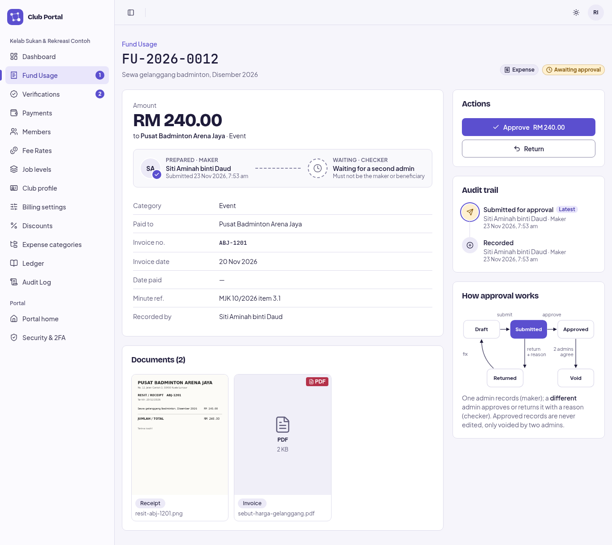

# Club Portal user guide

Short, task-based instructions. Member pages are in Bahasa Melayu by default (switch with **BM / EN** at the top), so
their labels are quoted in BM as they appear. Admin pages are in English. Everyone in the screenshots is fictional.

- [Members](#members): [pay by FPX](#pay-by-fpx) · [pay by bank transfer](#pay-by-bank-transfer--duitnow) ·
  [pay all at once](#pay-all-open-fees-at-once-bayar-semua) · [receipts](#view-an-invoice-or-receipt) · [pay ahead](#pay-ahead) · [install as an app](#install-as-an-app-pwa) · [2FA](#turn-on-two-factor-authentication)
- [Treasurer / club admin](#treasurer--club-admin): [bill the month](#bill-the-club-each-month-generate-fees) · [verify slips](#verify-transfer-slips) ·
  [record an expense or welfare case](#record-an-expense-or-welfare-case) · [approve a record](#approve-someone-elses-record) ·
  [bank details](#change-the-clubs-bank-details) · [plans and gateway fee](#billing-plans-and-gateway-fee) ·
  [bank charges](#bank-and-gateway-charges) · [ledger and the AGM](#the-ledger-and-the-agm) · [reminders](#overdue-reminders) ·
  [job levels](#set-up-job-levels-before-fee-rates)
- [Super admin](#super-admin): [install](#install-the-app) · [create a club](#create-a-club) · [grant club admin](#make-someone-a-club-admin)

---

## Members

Log in with the email and temporary password from your welcome email. The first time, the app asks you to **choose
your own password** (**Pilih kata laluan anda sendiri**): type the temporary password, then your new one twice. It
needs at least 12 characters; a few ordinary words together is easiest to remember. You can change it again later
at `/password/change`.

If you type a wrong password many times (10 in a row), signing in to your account pauses for 15 minutes and you get
an email about it. Wait and try again, or use **Lupa kata laluan?** to reset your password straight away.

**Utama** (home) shows:

- your membership card with **Jumlah perlu dibayar**: what you owe now, with a **Bayar RM …** button for the oldest
  fee and **Invois** (or **Bayar semua RM …** when more than one fee is open, see below);
- **Akan datang**: fees still open; **Aktiviti terkini**: your recent payments;
- **Ke mana wang anda pergi**: how much the club collected and spent this year (expenses + welfare + bank charges),
  by category in BM (totals only);
- **Akaun saya**: theme (system / light / dark), **Keselamatan & 2FA** and **Log keluar**.

**Bayaran** (bottom bar) lists all your fees by year.

 

### Pay by FPX

1. On **Utama**, tap **Bayar RM …** (or open a fee and choose to pay). The **Semak & bayar** page shows what the fee
   is for, the member, the club and the total.
2. Under **Pilih cara bayar**, keep **FPX (perbankan dalam talian)**.
3. Tap **Bayar RM …**. You go to ToyyibPay or Billplz, pick your bank and pay there. Don't close the window until it
   finishes.
4. You come back to a result page: **Berjaya** (paid), **Dalam proses** (still waiting for the gateway; the page checks
   again by itself) or **Bayaran belum diterima**. The fee is marked paid only when the gateway confirms it to the
   server, and the receipt is emailed to you.

If the club passes the gateway fee to members, the review page shows it as a separate line before you pay.

 

### Pay by bank transfer / DuitNow

No gateway charge. Shown only when the club has published its bank details.

1. On **Semak & bayar**, choose **Pindahan bank / DuitNow**.
2. Transfer the exact amount to the account shown (tap **Salin** to copy the account number or DuitNow ID).
3. Type the reference shown under **Rujukan (taip dalam pindahan)**, e.g. `YURAN-179`, in your bank's reference or
   note field, so the treasurer can match it.
4. Under **Hantar slip pindahan**, add 1 to 3 files (photo or PDF, up to 10 MB each). On a phone, **Ambil gambar**
   opens the camera.
5. Check **Tarikh pindahan**, optionally fill in **No. rujukan bank (pilihan)**, and tap **Hantar slip**.

 

The fee now shows **Menunggu pengesahan** / **Disemak** and is no longer counted as owed. **Don't pay it again.**
When the treasurer approves the slip, the fee becomes paid and the receipt is emailed to you. If the slip is
rejected you get an email with the reason, and the fee page shows **Slip anda belum diterima**: send the right slip or
pay online.

If you started an FPX payment for the same fee earlier, the page warns you: if money already left your account, wait
for that payment instead of transferring as well.

 

### Pay all open fees at once (Bayar semua)

When more than one fee is open (pending or overdue), **Utama** shows **Bayar semua RM …** with the total, and
**Bayar satu sahaja (yang paling lama)** for just the oldest fee. Open fees are always listed oldest first.

- **Semak & bayar semua** lists every fee in the set and the total.
- **FPX:** one bill, so one gateway charge for the whole set. When the gateway confirms it, every fee is marked paid
  together and the receipt has one line per fee.
- **Bank transfer:** one transfer and one slip for the whole set, with the reference `YURAN-G…` shown on the page.
  The treasurer approves or rejects the set together.
- If a fee changes after you opened the page (for example the treasurer edits an amount), you are asked to check the
  new total before paying. A fee already being checked from an earlier slip is left out.

 

### View an invoice or receipt

Open any fee from **Utama** or **Bayaran**. An unpaid fee shows its invoice; a paid fee shows the **Resit rasmi**
(official receipt) with the payment method (FPX with the transaction ID, or **Pindahan bank / DuitNow**). Both are
headed with the club's logo, name, registration no. and address (when the club has set them). The receipt number
looks like **RCP-2026-0001**: the club's prefix, the year its financial year started, and a running number. A
"Bayar semua" payment is one receipt with one number for all its fees. A receipt keeps the
club details it was issued with, so it doesn't change if the club later renames itself or changes its logo. If the
club has written a receipt footer, it is printed at the bottom of the receipt and the receipt email. Tap
**Cetak** to print or save it as PDF.

If the treasurer **cancels a payment** (for example a slip that could not be confirmed, or an online payment that
was refunded), you get an email, and the fee shows as unpaid again with a note at the top: "Resit RCP-2026-0001
telah dibatalkan pada 10 Mac 2026. Kami tidak dapat mengesahkan bayaran ini. Yuran ini belum dibayar." Pay it again
as usual (FPX or slip, on its own or with "Bayar semua"): you get a new receipt with a new number, and the fee page
still mentions the cancelled one. A "Bayar semua" receipt that was cancelled shows "Resit … dibatalkan" instead of
the receipt. If the money already left your account and was not refunded, don't pay again: contact the treasurer.

**Notis privasi** (privacy notice) is linked from **Utama** → Akaun and from the sign-in page.

 

### Pay ahead

On **Bayaran**, open **Bayar lebih awal** at the bottom:

1. Under **Tempoh**, pick 1, 3 or 12 months (only the plans your club allows; the club's default plan is marked
   **Disyorkan** and pre-selected). Longer plans mean fewer bills, so less in gateway charges for the club.
2. Choose **Bulan mula** (next month or later) and tap **Teruskan · RM …**.
3. A new invoice is created; pay it by FPX or transfer as above.

The price is your rate for each month the plan covers, added up: if the club has already set a new rate starting in
one of those months, those months are at the new rate. A month the club has waived (RM 0) adds nothing; a period of
only waived months has nothing to pay, so it isn't offered.

 

### Install as an app (PWA)

Club Portal can sit on your phone's home screen like an app (it is still the same website).

- **Android / Chrome:** on **Utama**, the **Pasang di skrin utama** card has a **Pasang** button. If you closed it,
  use the browser menu's "Install app" / "Add to Home screen".
- **iPhone / Safari:** tap the Share button, then **Tambah ke Skrin Utama** ("Add to Home Screen"). In-app browsers
  (WhatsApp, Facebook) can't do this: open the link in Safari first.

The app's name, colour and icon follow the portal's settings. A phone that installed the app earlier may keep the
old name or icon until the app is removed from the home screen and added again.

### Turn on two-factor authentication

**Akaun saya → Keselamatan & 2FA** (admins: **Security & 2FA** in the sidebar). Confirm your password, tap
**Enable 2FA**, scan the QR code with an authenticator app (Google Authenticator, Microsoft Authenticator, etc.) and
enter the 6-digit code. **Save the recovery codes** shown once: each one logs you in once if you lose your phone.
After 5 wrong codes the challenge locks for 15 minutes.

2FA is optional for members. **Admins (club admins and the super admin) must turn it on:** until they do, every admin
page opens the Security page instead, with a notice. To turn 2FA off you need your password **and** a code from the
app (or one recovery code). An admin who turns it off is asked to set it up again straight away.

---

## Treasurer / club admin

Admins log in at the same address. A new admin first chooses their own password (as members do), then turns on
2FA ([see above](#turn-on-two-factor-authentication)): the admin pages open once 2FA is on. After that they land on a page listing their clubs; open a club's **Dashboard**. The sidebar has **Dashboard**, **Fund Usage**,
**Verifications**, **Payments**, **Members**, **Fee Rates**, **Job levels**, **Club profile**, **Billing settings**, **Discounts**, **Expense
categories**, **Ledger**, **Audit Log**, **Portal home** (back to the list of your clubs) and **Security & 2FA**, the
same on every admin page. To see your own member view (admins pay fees too), use **Member view** in the account menu
(your initials, top right). The screen icon next to it switches the theme (light, dark or system).

The **Dashboard** shows the fund balance today (everything collected minus everything approved as spent), collected
and spent this year (spent = expenses + welfare + bank charges, with the split), records awaiting approval, a
12-month collected vs spent chart (**Show as table** for the numbers), transfer slips and approvals waiting for you,
and recent money events. Every figure says which period it covers, and the same figures appear on Fund Usage, the
Ledger and the member card.

**Two-person rule.** Anything that moves or redirects money needs a second admin: approving a Fund Usage record,
voiding one, changing the bank details, and approving a slip for your own fee. You can never check your own work or
your own fee.

### Bill the club each month (Generate fees)

Fees are not created on their own: once a month, bill the whole club in one go.

1. **Fee Rates** first: every [job level](#set-up-job-levels-before-fee-rates) needs a monthly rate. A new rate can
   start on a later date (for example 1 January); the old rate stays in force until the day before. A rate can also
   start on an earlier date to correct one ("RM 8 since October"): it replaces every rate of that level from its
   start, including one saved before that starts later (kept in the list as **Replaced before it started**).
   Deleting a level's current rate puts the rate before it back in force. A rate of **RM 0** waives the month.
2. **Payments → Generate fees for a month.** Pick the month (this month or next month only) and the **due date**
   (by default the 15th, or today when that has passed; it can't be in the past, or the overdue reminder would
   email everyone the next morning, nor before the month starts), then **Show the list**.
3. The list shows every member and what will happen: **Will be billed** (amount, level and rate) or **Skipped** with
   the reason:
   - **Inactive membership**: set inactive on Members.
   - **Joined after the month**: their join date is after the month's last day.
   - **No fee rate for their level**: their level has no rate for that month.
   - **Rate is RM 0**: their level's rate for that month is RM 0 (waived): no fee is created.
   - **Already has a fee covering the month**: any fee of theirs that covers part of the month, whatever its status
     (paid, unpaid, overdue, a cancelled payment, a quarterly or yearly plan paid ahead).
4. Check the count and total, then **Create N fees**. Each fee is a monthly fee at the member's rate for that month,
   with no discount. Nobody is emailed: members see the new fee in the portal, and the
   [overdue reminder](#overdue-reminders) follows the due date. Admins' own fees are created too.

If anything changed after you opened the list (a member, a rate, a fee, even one member swapped for another at the
same amount), nothing is created and you are asked to look at the list again. A member set inactive while the fees
are being created is skipped. Running the same month again is safe: only members not billed yet are added (with a new due date
if you pick one). One limit: a fee you **deleted** on purpose is created again when you generate that month again, so
after deleting one, set the member inactive or check the list before confirming. Every fee created is in the
**Audit Log** ("Payment Created", with the run's key) plus one **Fees Generated** row with the month, count, total and
the skipped counts.

To bill one member by hand (a different amount, a discount, a quarterly fee), use **Payments → Add** as before.

### Verify transfer slips

1. Open **Verifications** (the badge shows how many are waiting). Each card shows the member, fee, amount, transfer
   date, the reference to look for (`YURAN-…`) and the member's bank reference, with the slip beside it (click to open).
2. Find the money in the club's bank statement.
3. **Approve**: set **Date received** (when the money reached the club's account), optionally a **Bank reference**,
   and confirm. The fee is marked paid by bank transfer and the member gets the receipt by email.
4. Or **Reject** with a reason the member will read (e.g. "Amount is RM5 short"). The member is emailed and can send a
   new slip.

**Recently handled** lists past decisions. You can't approve a slip for your own fee; another admin must.

A **Bayar semua** slip shows as one card with every fee it covers and the total (also one row on the dashboard).
Approving or rejecting it moves all the fees together. If one of them was paid online in the meantime, the card says
so and shows the amount to refund; the rest can still be approved.

### Cancel a payment

Use **Cancel payment…** on a paid fee's payment page when a payment turns out not to be good: an approved slip
was fake, the money never reached the club, a payment was recorded by mistake, or an online payment was refunded to
the member. (The status on the Edit page can no longer take a fee back from Paid.)

1. Open the fee under **Payments** and choose **Cancel payment…**.
2. Pick the **reason**. Only the reasons that fit how it was paid are offered: a checked slip (not genuine, money
   not received, recorded by mistake, other), recorded by hand with "Record payment…" (money not received, recorded
   by mistake, other), online FPX (refunded, other: the gateway confirmed that money, so it is never "not
   received").
3. Optionally add a **note** (up to 500 characters). It is for the admins and the audit log only; the member never
   sees it.
4. Tick the confirmation and **Cancel payment**.

What happens:

- The fee is unpaid again. Its receipt number becomes void (never reused) and paying again issues a new one.
  Exception: if the member paid online while their transfer slip for that fee was still being checked, cancelling
  the online payment puts the fee back to **awaiting verification** on that slip (the member is told the slip is
  still being checked, not to pay again); then approve or reject the slip as usual.
- A fee paid in a set ("Bayar semua", one FPX bill or one slip) shares its receipt with the other fees, so the
  whole set is cancelled together: the form lists the fees and the total first. A fee of the set that was already
  taken back and receipted on its own is left alone.
- Everything stays on record: the payment page lists every cancelled payment (date, by whom, receipt number,
  amount, reason and note), the slips stay attached (a fee with slips still can't be deleted), and the Audit Log has
  one **payment.cancelled** row per fee.
- The member gets one email (BM and EN) with neutral wording for the reason, for example "Kami tidak dapat
  mengesahkan bayaran ini" or "Bayaran ini telah dikembalikan kepada anda".
- A cancelled online payment can't come back: a repeat of its gateway callback is ignored.
- You can't cancel a payment for your own fee; another admin must (the super admin can).

**Figures**: a cancelled fee is no longer income. It drops out of the collected total (and any gateway charge the
club absorbed on it) for the date it was paid. Cancelling a payment dated in an **earlier financial year** changes
that year's totals (the form warns you); if that year was already reported at an AGM, the Audit Log is the trail
of what changed and why.

### Record an expense or welfare case

1. **Fund Usage → New expense** (or **New welfare case** for a "sumbangan kebajikan").
2. Fill in the category, payee, description, amount, invoice/bill number, invoice date, **Date paid** (when the money
   left the account) and the **Meeting minute ref.** if the committee approved it in a meeting. Under each date
   field the picked date is written out (e.g. "16 Nov 2026"), so day and month can't be mixed up. If something is missing when you submit, a list of what to fix
   appears at the top and the cursor moves to it.
3. Attach the documents (PDF, JPG, PNG or WebP, up to 10 MB each, at most 10 per record) and set each one's kind
   (Invoice, Receipt, Bank slip, Acknowledgement, Other). Files are stored encrypted and only club admins can open them.
4. **Save draft** to finish later, or **Submit for approval**. Once submitted, documents are locked.

The list shows each record's status: draft, **Awaiting approval**, **Returned** (fix it and submit again), **Approved**
or **Void**. Only approved records count towards balances, the member summary and reports.

**Welfare cases** also ask for the beneficiary member, the deceased or affected person, the relationship and who was
paid (next of kin), and use **Date approved by committee** (required) in place of the invoice date. These details are stored encrypted and shown to admins only. Tick **Death certificate sighted (not
uploaded)** and record who saw it and when, instead of uploading the certificate. Upload proof of payment (bank slip
or signed acknowledgement); it is needed to submit unless the certificate was sighted. Don't type personal details
in the description: descriptions appear in the ledger and audit log.

 

### Approve someone else's record

1. Open the record from **Fund Usage** (the **Awaiting my approval** tab) or the dashboard's **Approvals queue**.
2. Check the amount, payee and every document. The approval rail shows who prepared it and that it is waiting for a
   second admin; the **Audit trail** shows each step.
3. **Approve RM …** and tick the declaration that you have no conflict of interest (you are not the payee, the
   beneficiary or a relative, and you checked the documents). The declaration is logged.
4. Or **Return** it with a reason; the maker fixes it and submits again.

You can't approve a record you recorded, or a welfare case where you are the beneficiary. To cancel an approved
record, one admin uses **Void** with a reason and a different admin confirms it; voided records stay visible for audit.

### Change the club's bank details

Members pay into whatever these say, so a change needs a second admin.

1. **Billing settings → Bank transfer / DuitNow**: edit the bank name, account holder, account number and/or DuitNow
   ID, then **Save billing settings**.
2. The change is held. Members keep seeing the current details, and every club admin is emailed.
3. Another club admin (or the super admin) opens **Billing settings**, compares **Now (members see)** with
   **Requested** and clicks **Approve new details**. The requester can't approve their own change, only **Cancel my
   request**; other admins can also **Cancel this change**.

Switching **Offer bank transfer / DuitNow to members** off takes effect at once (no approval needed).

### Club profile and financial year

**Club profile** (sidebar) holds what members see at the top of their invoices and receipts, and on the ledger PDF:

- **Club name** and **Logo**: PNG, JPEG or WebP up to 2 MB and 4000 × 4000 pixels (no SVG or GIF). The server resizes
  it to 512 pixels and saves it as a PNG. Tick **Remove the logo** to go back to the plain mark. Members see it on their
  home page and receipts; with only one active club in the portal, the sign-in page shows it too.
- **Contact email**, **Registration no. (ROS/PPM), optional** and **Address** (several lines): shown as you type them.
- **Financial year starts in**: the month your club's year begins. "This year" on the Dashboard, Fund Usage, the Ledger
  (its default period and the year preset) and the members' "where the money went" page then runs from the 1st of that
  month, labelled e.g. **FY 2026/27**. January (the default) is the calendar year.
- **Receipt number prefix**: 2 to 6 capital letters or digits (default **RCP**). See [Receipt numbers](#receipt-numbers).
- **Receipt footer** (optional): plain text of up to 300 characters, printed under "This is a computer-generated
  receipt" on the official receipt and the receipt email, e.g. a thank-you note or the treasurer's contact. Line
  breaks are kept; tabs and other control characters are refused; anything that looks like HTML is shown as typed.

Every change is in the Audit Log with the old and new values. **Receipts already issued keep the details they were
issued with**: a fee paid before you change the name, logo or receipt footer still shows the old ones on its receipt. (Fees paid
before this feature existed show the club as it is now.) Unpaid invoices always show the current details. Old logo
files are kept on the server for that reason.

### Receipt numbers

Every receipt gets a number of its own club when the fee is marked paid (online, slip approved, or recorded by
hand): **PREFIX-YEAR-NNNN**, e.g. **RCP-2026-0001**. YEAR is the year the club's financial year started (with a
July start, money paid on 30 June 2026 is RCP-2025-…, money paid on 1 July 2026 starts RCP-2026-0001). The
running number starts again at 0001 each financial year and is counted per club. The year is the one the money was
**paid** in (the "date received" on the receipt and in the Ledger), not the day it was approved: a slip sent on
28 June and approved on 2 July is numbered in the year that ended on 30 June. So a late approval or a backdated
"Record payment…" can still add a number to the previous year. The number is fixed once issued: correcting the
date received later does not renumber it.

- **One payment, one number**: a "Bayar semua" FPX bill or transfer slip is one receipt, so all its fees share one
  number; each fee is listed on it with its invoice number. Each fee's own receipt page says it is part of that
  receipt (how many fees, the total) and links to it; sharing from there sends the whole receipt.
- **Audit Log**: every fee marked paid names its receipt number, and cancelling a payment or deleting a fee names the
  number that became void, so every gap in the sequence can be explained.
- **Never reused**: a fee taken back from paid ([Cancel payment](#cancel-a-payment)) loses its receipt number,
  which stays recorded as void (shown on the payment page as "Earlier receipt no."); when the fee is paid again it
  gets a new number. The numbers are therefore never reused, but they are **not guaranteed gap-free**.
- **Prefix**: set on **Club profile**. A new prefix is used only for receipts issued from then on; the year's running
  number carries on (e.g. RCP-2026-0007, then KBS-2026-0008). The page shows the next number.
- Fees paid before receipt numbers existed keep their old number (**RCP-** and the fee number, **RCP-G…** for an old
  "Bayar semua").

The number is on the member's receipt, the receipt email, the Payments list and payment page and the Ledger (screen, CSV column
**Receipt No.** and PDF).

### Billing plans and gateway fee

Also on **Billing settings**:

- **Billing plans members can choose**: monthly, quarterly and/or yearly for paying ahead, and the **Default plan**
  that is pre-selected. Yearly or quarterly billing means fewer gateway charges.
- **Gateway fee**: **Club absorbs it** (members pay the fee amount only) or **Member pays it** (shown on the review page
  and added to what they pay). For ToyyibPay clubs "Member pays it" stays disabled until it has been checked in the
  ToyyibPay sandbox and enabled on the server.
- **Gateway fee per bill (RM)**: what your gateway plan charges per bill (e.g. RM1.00). Used for the review page,
  savings hints and the dashboard's fee total; the gateway applies its own fee.

See [payment-options.md](payment-options.md) for a comparison of charges.

### Bank and gateway charges

When the club absorbs the gateway fee, each online payment's charge counts as spending: it appears in **Spent** as
**Bank charges** (dashboard, Fund Usage, member card) and as one **Bank / gateway charges** row per month in the
ledger. You don't record these yourself.

Record a charge by hand, as a normal expense in a **Bank charges** category (create it under **Expense categories**
if your club doesn't have it), when:

- the bank charges the club something the portal can't see (monthly account fee, DuitNow or IBG charges); or
- you **cancelled a payment made online**: its gateway charge leaves the figures while the fee is not paid, and
  counts again if you mark the fee paid by hand. But if the member then settles it by transfer slip or a new online
  bill, that payment replaces the earlier charge (none for a slip, the new bill's own charge), so the first gateway
  charge is no longer counted. The gateway still kept it: record it as a bank-charges expense with the gateway
  statement as the document.

Each category can have a **Name in Bahasa Melayu** (Expense categories page); members see that name on their
"Ke mana wang anda pergi" card, and the English name when it is empty.

### The ledger and the AGM

1. **Ledger**: choose **This year**, **Last 12 months** or **Custom dates** (up to 24 months).
2. The **Opening balance** is worked out from the records (everything collected minus everything approved as spent
   before the start date), so it matches the dashboard. **Set manually** overrides it, e.g. with the balance from
   last year's audited accounts; the page and the exports then mark it "(diubah secara manual)" and show what the
   records say.
3. Read the summary tiles (money in, money out with the expenses / welfare / bank charges split, closing balance),
   **Month by month** (**Show as chart** for a chart) and the transactions with a running balance. **Fees not yet
   received** lists open fees; they are not in the balance until paid.
4. **Export CSV** (opens in Excel / Google Sheets) or **Export PDF** (A4 landscape for the AGM). Both use the same
   period and opening balance as the page.

**Which figure to quote at the AGM.** Use the **closing balance** for the financial year (**This year**, or **Custom
dates** for your club's year), exported as PDF. If last year's accounts were audited, set the opening balance
manually to the audited figure and say so ("opening balance per audited accounts"); the closing balance is then
that figure plus this year's money in minus money out. If you don't set it, quote the computed figures: they are
the same ones the dashboard and members see.

**Dates differ from the bank statement.** Fees paid online are dated when the gateway confirmed the payment, but the
gateway pays the club later (often the next working day, in batches, net of its fees for some plans). Transfers are
dated with the **Date received** you entered when approving the slip. So a month-end balance can differ from the bank
statement by payments still in transit; match them by the bill reference or `YURAN-…` reference, not by date.

### Overdue reminders

Every day at **08:00 Malaysia time** the portal marks fees past their due date (plus the club's grace days) as
overdue and emails each member a reminder, once per fee. Only active members of an active club are reminded: a fee of
an inactive or removed member, or of an inactive club, is left as it is and nobody is emailed. If the member is made
active again, the next morning's run reminds them. This needs the server's cron job and `APP_TIMEZONE=Asia/Kuala_Lumpur` (set by the installer; see
[INSTALL.md](INSTALL.md)). Without the time zone it runs at 08:00 UTC, which is 4 pm in Malaysia.

### Set up job levels before fee rates

Each club has its own **job levels** (tahap jawatan): every member is on one, and the monthly fee is set per level. A
new club starts with one level, **Ahli**, so a club where everyone pays the same needs nothing more. To charge
different amounts (for example by grade), set the levels up first, then the fee rates, then add members:

1. **Job levels** (sidebar, next to Fee Rates; also linked from the Fee Rates page). **Add Job Level** with a name
   such as "Pegawai" or "Staf Sokongan". It goes last in lists unless you give an **Order** number (lower comes
   first). Rename **Ahli** too if you like.
2. **Fee Rates → Set New Rates**: one monthly amount for each active level.
3. **Members**: pick the level for each member (or import a CSV; see below).

Each level gets a short **code** made from its first name (`pegawai`, `staf_sokongan`), shown on the Job levels page.
The code never changes, so a renamed level shows its new name everywhere (members, fee rates, dashboards). Two
levels of one club can't share a name (capitals don't count).

**Retire a level** with **Deactivate**: it is no longer offered for new members or new fee rates, but members already on
it keep it (and keep paying its rate) until you move them, and it still shows by name. **Reactivate** brings it back.
**Delete** (the bin) is offered only for a level that no member and no fee rate (current or past) is on; a club always
keeps at least one active level. Every add, rename, reorder, deactivation and deletion is in the club's **Audit Log**.

### Other admin tasks

- **Members**: add a member (they get a welcome email with a temporary password, which they replace at their first
  sign-in) or **Import** a CSV (template on the
  import page; up to 1,000 rows). Emails are matched without regard to capitals, so `Ali@club.my` is refused when
  `ali@club.my` already has an account; a CSV saved by Excel on Windows (accented names such as "José") is read
  correctly. The `job_level` column takes one of the club's active [job levels](#set-up-job-levels-before-fee-rates)
  by name or by code, in any case (`Pegawai`, `pegawai`); the import page lists them and the template uses one.
  Club admins can't add or change club admins; only the super admin can.
  **Removing** a member only takes them out of the club: their fees and payments stay (shown as theirs, or "Former
  member" if the account is deleted later), so the fund figures, ledger and AGM history don't change. To stop
  someone being billed while keeping them listed, set them inactive instead.
- **Fee Rates**: monthly fee per active [job level](#set-up-job-levels-before-fee-rates). **Discounts**: fixed or
  percentage discounts.
- **Payments**: all fees, [generate the month's fees](#bill-the-club-each-month-generate-fees), add one fee by hand,
  mark a fee paid by hand (not your own), or
  [cancel a payment](#cancel-a-payment). On a phone the status shows
  under the member's name and the table scrolls sideways for the rest.
- **Audit Log**: every change in the club, who made it and when.

---

## Super admin

### Install the app

The full first-install steps (server requirements, `.env`, `migrate --force`, email, cron, upload limits, MySQL,
backups and troubleshooting) are in [INSTALL.md](INSTALL.md). The installer itself works like this:

1. With `.env` ready and `php artisan migrate --force` done ([INSTALL.md steps 5–6](INSTALL.md#step-5-create-env)),
   open `https://<your-domain>/install`. **Club Portal Setup** checks PHP, the PDO extension for your database (MySQL / MariaDB
   or SQLite) and that `storage/` and `.env` are writable.
2. Enter the **INSTALL_TOKEN from your .env**, the application name and URL (the exact `https://` address members will
   use), and the super admin's name, email and a strong password (12+ characters with upper and lower case, numbers
   and symbols).
3. **Install Application** runs the migrations, creates the super admin, writes production settings and blanks the
   token. The installer can't run again afterwards.

Then turn on 2FA for your account and finish the rest of [INSTALL.md](INSTALL.md#step-8-email-smtp) (email, webhook
secret, upload limits, `config:cache`, cron). The ToyyibPay webhook secret lives in `.env`; the Billplz X-Signature
key goes in `.env` or per club (club settings).

### Create a club

**Clubs → New Club**: name, email, logo, and the payment gateway (ToyyibPay or Billplz) with that club's credentials
(stored encrypted; leave empty to use the global ones in `.env`). The club starts with one job level, **Ahli**. Then,
from the club's pages, set up its [**Job levels**](#set-up-job-levels-before-fee-rates), **Fee Rates**, **Expense
categories** and **Billing settings**, and add members.

On **Statistics**, "Members by job level" adds up levels with the same name across clubs ("Manager" in two clubs is
one bar), since each club names its own levels.

### Make someone a club admin

Only the super admin can grant the club-admin role:

- **Members → Add member** for the club and set **Club Role** to **Admin**; or
- edit an existing member of the club and change the role to Admin.

Grants are audited and emailed to the club's admins. Give each club at least two admins so there is always a second
person to approve. **Administrators** lists all admin accounts and lets you add another super admin; the last super
admin can't be demoted or removed.

**Statistics** and **Audit Log** (super admin section of the sidebar) cover all clubs.

### Portal settings

**Portal settings** (super admin section of the sidebar) sets the **portal name** (page titles, the sign-in pages,
emails and the admin sidebar; left empty it is the `APP_NAME` from `.env`) and the **portal logo** (same rules as a
club logo), shown in the admin sidebar and on the sign-in pages. When exactly one club is active, the sign-in pages
show that club's name and logo instead, with the portal name under it. Changes are audited.

- **Brand colour:** pick one of six colours (Lavender, the default, Teal, Blue, Green, Maroon, Slate). Each row shows
  a sample button, link and tag in light and dark mode. It colours buttons, links, highlights and focus outlines on
  every page (member app, sign-in and error pages, admin pages) and the browser bar on phones. Status colours (paid,
  overdue, pending) and the charts keep their own colours, and receipts and emails are not affected. There is no
  free colour field: every preset is checked to stay readable (WCAG AA contrast) in light and dark mode.
- **App icon:** with a portal logo, the installable app (Add to Home Screen), the iPhone home-screen icon and the
  browser tab use icons made from it: the logo on white, and for Android's shaped icons the logo on a white circle
  over the brand colour. Without a logo, or when the server lacks the PHP GD extension, the built-in icon is used.
  A logo saved before this release gets its icons the next time Portal settings is opened. The app's name is the
  portal name. **Phones that already installed the app may keep the old icon and name** until the app is removed
  from the home screen and added again (browsers refresh them on their own schedule, sometimes days later).

### Privacy notice

**Privacy notice** (super admin section of the sidebar, under Portal settings) holds the portal's privacy notice in
**Bahasa Melayu** and **English** (up to 10,000 characters each) and an optional **data protection contact** (a name
or role and an email). Anyone can read it at `/privacy`, without signing in: it is linked from the sign-in pages and
from the member app (**Utama** → Akaun). The page is in BM by default with the BM/EN switch; when only one language
is filled in, both switches show that one and say so.

The text is plain text: leave a blank line between paragraphs; HTML or Markdown is shown as typed, never run. No
wording is supplied for you: until a notice is saved, `/privacy` says "The club has not published its privacy notice
yet. Ask your club administrator." Write the notice with whoever is responsible for your club's personal data (in
Malaysia, the PDPA 2010 applies). Every change is in the platform Audit Log.
